<p align="center">
  
</p>

<h3 align="center">The 1997 classic, rebuilt from scratch in Rust.</h3>

<p align="center">
  An unofficial, clean-room reimplementation of the <b>Total Annihilation</b> engine that plays your own copy of the game
  on modern hardware: any resolution, a physically based renderer with ray tracing, twenty thousand units in one battle,
  a cockpit in every unit, lockstep multiplayer and a launcher with one-click mods.
</p>

<p align="center">
  <a href="https://github.com/Jared-woodruff/TA-Reborn/releases/latest"></a>
  
  
  
  <a href="#credits"></a>
</p>

<p align="center">
  <b>
    <a href="#trailer">Trailer</a> ·
    <a href="#get-started">Download</a> ·
    <a href="#features">Features</a> ·
    <a href="#the-battlefield">Battlefield</a> ·
    <a href="#construction">Construction</a> ·
    <a href="#perspective">Perspective</a> ·
    <a href="#command">Command</a> ·
    <a href="#ways-to-play">Ways to play</a> ·
    <a href="#the-launcher">Launcher</a> ·
    <a href="#worlds">Worlds</a> ·
    <a href="#mods">Mods</a> ·
    <a href="#build">Build</a>
  </b>
</p>

<a id="trailer"></a>

https://github.com/user-attachments/assets/2a427597-c3cf-4de3-8f54-85b20aa2edb0

<p align="center"><sub>The 1.0 launch trailer, filmed in the game. Its music, “The War Reborn” by Hadal Static, is an original track made for TA Reborn.</sub></p>

> [!IMPORTANT]
> TA Reborn contains **no original game data**: no units, maps, art, sound, music or video. It needs
> a legitimately owned copy of Total Annihilation, such as *Total Annihilation: Commander Pack* on
> [GOG.com](https://www.gog.com/game/total_annihilation_commander_pack) or
> [Steam](https://store.steampowered.com/app/298030/). Every unit, map, campaign and sound is TA's
> own, read in place from your install; everything around them is new. TA Reborn is an unofficial
> fan project, not affiliated with or endorsed by the game's owners.

<p align="center">
  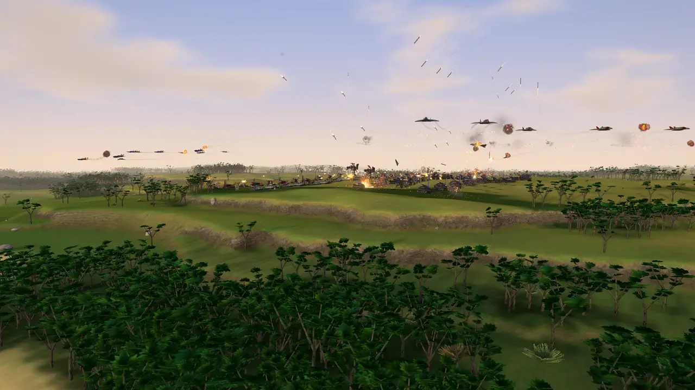
</p>

<a id="features"></a>

## Everything at a glance

<table>
  <tr>
    <td width="33%" valign="top">
      <b><a href="#the-battlefield">The battlefield</a></b><br>
      <sub>Every world its own sky and light · physically based rendering · ray-traced shadows and reflections · surf, wakes and caustics · lava that crusts and glows · rain that soaks the ground · dawn, dusk and moonlit nights · fireballs drawn per pixel · 20,000 units in one battle · two art styles · nineteen skins and an editor</sub>
    </td>
    <td width="33%" valign="top">
      <b><a href="#construction">Construction</a></b><br>
      <sub>Nano-lathe beams and build lattices · buildings rising out of the green and sagging into rubble · factories that roll their units out · reclaim, wrecks and heaps</sub>
    </td>
    <td width="33%" valign="top">
      <b><a href="#perspective">Perspective</a></b><br>
      <sub>Ride along in any unit · eight modelled cockpits · a fighter's helmet display, a tank's sight, a walker's HUD · rain on the glass</sub>
    </td>
  </tr>
  <tr>
    <td valign="top">
      <b><a href="#command">Command and control</a></b><br>
      <sub>The command deck, or TA's own 1997 panel · a radial menu on any unit · builders on duty · formations that march as armies · strategic zoom · a companion screen for a second display · photo mode · all of TA's keys and commands · gamepads</sub>
    </td>
    <td valign="top">
      <b><a href="#ways-to-play">Ways to play</a></b><br>
      <sub>Skirmish for ten · every campaign of your install · Conquest · thirteen scenarios · lockstep multiplayer · replays with a cast view, highlights, MP4 export and social clips · a debrief after every battle</sub>
    </td>
    <td valign="top">
      <b><a href="#computer-players">Computer players</a></b><br>
      <sub>They build, raid, nuke and fight at sea · they scout for you and never see through the fog · personas with names and manners · transmissions in battle · rivals who remember you · cheats that cost the battle its career</sub>
    </td>
  </tr>
  <tr>
    <td valign="top">
      <b><a href="#the-launcher">The launcher</a></b><br>
      <sub>Finds GOG and Steam copies · mods from ModDB in a click, remembered by your saves · a map library · skins with an editor · commander profiles, XP, 21 ranks and 134 achievements · a benchmark · music · updates</sub>
    </td>
    <td valign="top">
      <b><a href="#worlds">TA Reborn's worlds</a></b><br>
      <sub>29 maps of its own: forests, deserts, islands, fire, metal, space, winter villages, and Australia, the USA and the whole world</sub>
    </td>
    <td valign="top">
      <b><a href="#the-archives">The Archives</a></b><br>
      <sub>Every unit on show, wallpapers to 8K · the intro's 1997 bedroom, festive in December · the Galactic War's chronicle and archive · a title screen that films the worlds · credits timed to a song of their own · a jukebox · fourteen languages</sub>
    </td>
  </tr>
</table>

<br>

<a id="the-battlefield"></a>
<p align="center">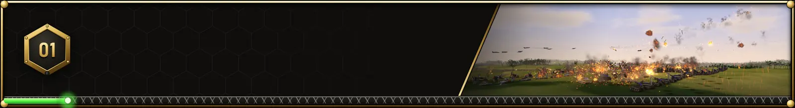</p>

TA's worlds, lit as they never were. Each has a sky and a light of its own; hills cast long shadows
and steep faces stand as walls of rock; surf breaks along the shores and ships leave wakes; fire
burns through orange to white; rain soaks the ground and stands in puddles that mirror the sky; and
past the map's edge the world runs on to the horizon. Seen from TA's usual height the battle keeps
the art exactly as it was painted.

<table>
  <tr>
    <td width="50%" align="center"><br><sub><b>War at sea</b>: bow waves and wakes, surf on the shores, hulls seen through the water</sub></td>
    <td width="50%" align="center"><br><sub><b>The air war</b>: Thunders out of the setting sun over a Core base</sub></td>
  </tr>
  <tr>
    <td align="center"><br><sub><b>Weather</b>: showers that soak the ground and dry after</sub></td>
    <td align="center"><br><sub><b>Lava worlds</b>: the melt crusts over, glows through its cracks and lights the rock</sub></td>
  </tr>
  <tr>
    <td align="center"><br><sub><b>Experimentals</b>: a Krogoth walks out of the dusk</sub></td>
    <td align="center"><br><sub><b>Nuclear strikes</b>: the flash, the shockwave, the fireball</sub></td>
  </tr>
  <tr>
    <td align="center"><br><sub><b>Time of day</b>: an Arm column fords the river at first light</sub></td>
    <td align="center"><br><sub><b>Fire</b>: a wood burning under the hunter's moon</sub></td>
  </tr>
</table>

<p align="center">
  
  <br><sub><b>Twenty thousand units</b> fill Reactor Grid edge to edge, the camera pulling back until their front is a seam of fire across the map</sub>
</p>

- **A modern renderer for TA's art**: physically based lighting, soft shadows that harden at the
  contact, ambient occlusion, HD surfaces that wear paint, soot and embers, and the ground's own
  materials (sand, soil, turf, rock, snow, ice, volcanic rock, metal, lunar dust) told from TA's
  painted colours. On cards that trace rays: ray-traced shadows, occlusion and reflections.
- **Worlds of their own**: smoke over lava, smog over metal and cities, violet over crystal, a black,
  starry sky on the moon; dull worlds graded as their painters meant them. Beyond the map's edge
  the world runs on: the map's own ground across the edge, then land and sea like the map's round
  that stretch of it (a metal world's city of plating, the moon's craters), never copies of it.
- **Water**: surf and whitecaps, shallows graded by depth with caustics on the bed, bow waves and
  wakes behind ships and hovercraft, hulls and wading legs seen through the water. Lava crusts and
  glows; acid looks like acid.
- **Time and weather**: dawn, dusk, a moonlit night (bases light up, aircraft blink their beacons)
  or a full day and night; showers that soak the ground and dry; the wind across the land, gusts
  running over the grass in soft cat's paws, sand streaming and snow drifting the way it blows.
- **Battles with weight**: vehicles squat, dip and lean on their suspension; guns kick their units
  back and big blasts shove the units round them; walkers walk in step with the ground and leave footprints the shape of their feet; aircraft
  fall trailing smoke; ships list and go under; shells landing in the sea throw up spray.
- **3D close to the ground**: TA's painted trees, rocks, crystals, ruins, pipework and relays stand
  as models of TA Reborn's own when the camera comes down to them.

<p align="center">
  
  <br><sub><b>Two art styles</b>: Enhanced Classic keeps TA's own models and paint; Reborn rebuilds every unit, mods' too, with armour plates, bolts and road wheels, and repaints its metal four times as fine</sub>
</p>

- **Skins**: eighteen built-in liveries laid over every unit's own detail (Heritage's battle-worn TA
  as it was; desert, winter, woodland, navy, urban, tiger and night camouflage; Christmas, Halloween
  and parade dress; and the colours of seven nations), for your army, the enemy or both, and an
  editor to make your own.

<br>

<a id="construction"></a>
<p align="center">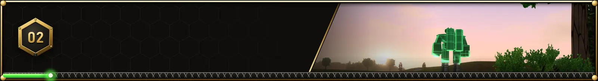</p>

<p align="center">
  
  <br><sub><b>A morning in a few seconds</b>: a base rising on Highland Rift, eight times as fast</sub>
</p>

Everything is built the way TA built it: a constructor plays its nano-lathe on the ground, a green
lattice of the building rises out of the beams and fills in, and the finished building unfolds. Here
the beams are streams of light that arc and splash, the lattice glows and shimmers as it fills,
wrecks are reclaimed into metal, and a destroyed building sags into its rubble.

<table>
  <tr>
    <td width="50%" align="center">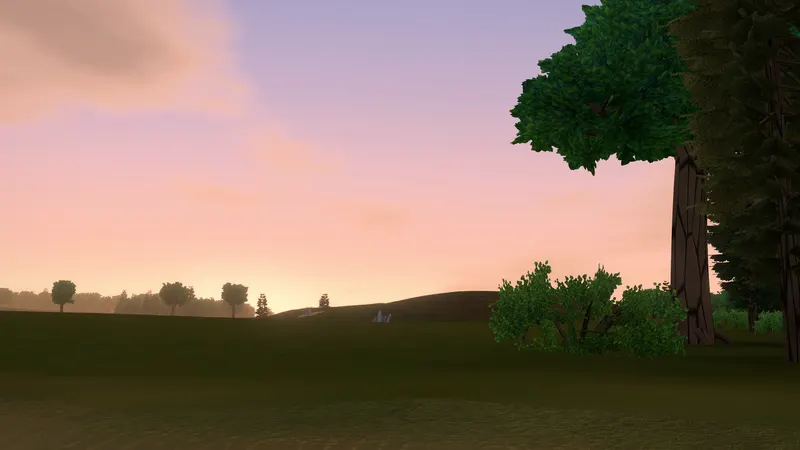<br><sub><b>The Commander arrives</b>, rising out of its lattice against the sunrise</sub></td>
    <td width="50%" align="center"><br><sub><b>The first extractor</b> rises on its deposit</sub></td>
  </tr>
  <tr>
    <td align="center"><br><sub><b>Solar collectors</b> rise and unfold</sub></td>
    <td align="center"><br><sub><b>Factories at work</b>: the kbot lab opens and its first Peewee walks out</sub></td>
  </tr>
  <tr>
    <td align="center"><br><sub><b>Building at sunset</b>, the beams green in the low gold light</sub></td>
    <td align="center">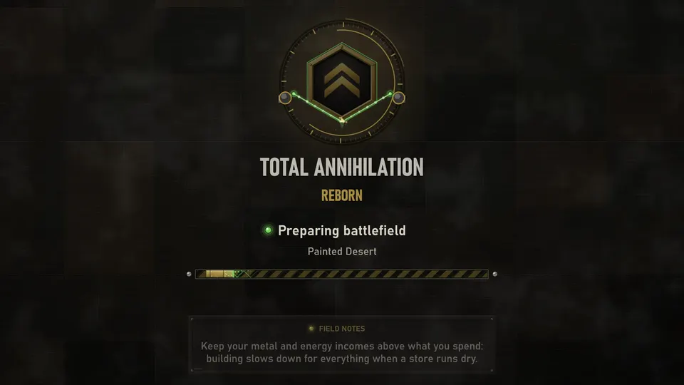<br><sub><b>Even the loading screen</b>: two nano-lathes build the emblem while you wait</sub></td>
  </tr>
</table>

<br>

<a id="perspective"></a>
<p align="center">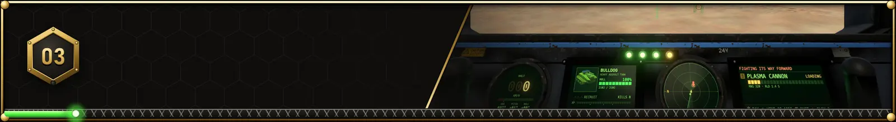</p>

<p align="center">
  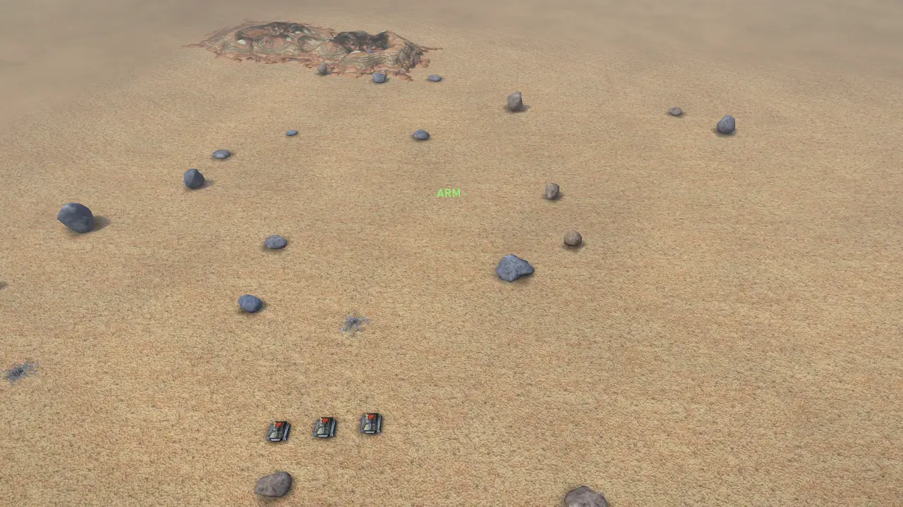
</p>

Select a unit and press **Q**: the camera dives into it, onto a tank's turret, into a walker's
head, onto a ship's bridge, up a submarine's periscope or into a fighter's canopy, and you ride
along while it goes on with its orders. The mouse looks round, the wheel magnifies the sight, and
Escape climbs back out.

- **Eight modelled cockpits**, made in Blender for TA Reborn: a tank's vision port, a kbot's visor,
  the Krogoth's heavy cab, the Commander's helmet, a ship's bridge, a fighter's canopy, a gunship's
  glass, a gun house's slit in concrete. Their dashes are worn working metal: chipped paint, stencils,
  caution plates and guarded switches. Glass in every window: dust that catches the sun, and in the
  rain drops that cling and run down it.
- **Instruments for each kind**: a fighter's helmet display (the pitch ladder, the heading tape,
  speed and altitude, the flight path) and a glass panorama in the cockpit; a tank's sight with its
  range finder, ammunition and turret's bearing; a walker's HUD with its armour by section, torso
  twist, throttle and weapon groups. Every cockpit gives its speed in figures, the unit's figures,
  its heading, pitch and roll, and the weather outside; the radar scope and each weapon's reload too.
  One fact in one place: the glass keeps what you aim by, the dash the rest.
- **Yours, an ally's, or anyone's**: ride along with an ally's unit, or any unit in a replay or as a
  spectator. You hear the battle from inside the hull, the glass cracks as it wears, the cabin lamp
  stutters as the hull fails, and a unit lost takes its signal with it.

<table>
  <tr>
    <td width="50%" align="center"><br><sub><b>A fighter's helmet display</b>, banking through a dogfight</sub></td>
    <td width="50%" align="center"><br><sub><b>A walker's HUD</b>: armour by section, torso twist, weapon groups</sub></td>
  </tr>
</table>

<br>

<a id="command"></a>
<p align="center">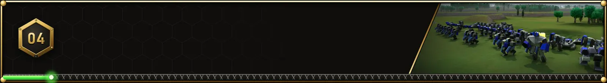</p>

<p align="center">
  
  <br><sub><b>The command deck</b>: the minimap top right, the economy in the top bar, the selection and its orders below; a right-click on a unit rings its orders round the pointer</sub>
</p>

<table>
  <tr>
    <td width="50%" align="center">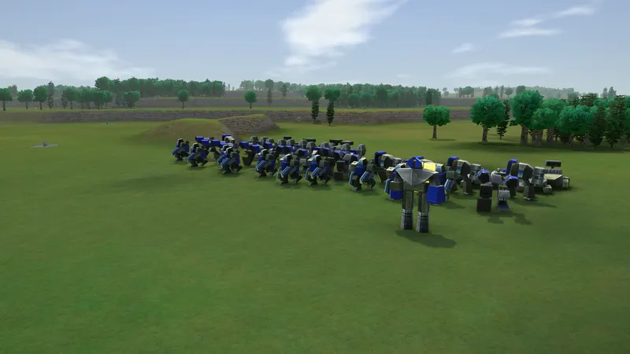<br><sub><b>Formations</b>: a group sent somewhere shuffles into rows, the short-ranged in front</sub></td>
    <td width="50%" align="center">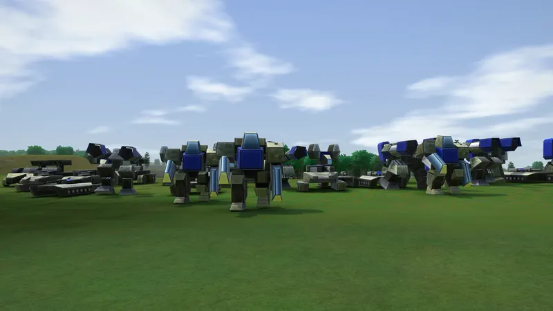<br><sub>…and marches side by side at the pace of its slowest unit</sub></td>
  </tr>
  <tr>
    <td align="center"><br><sub><b>Or TA's own 1997 interface</b>, in TA's oblique view, crisp at any size</sub></td>
    <td align="center"><br><sub><b>Strategic zoom</b>: pull back and every unit becomes an icon</sub></td>
  </tr>
  <tr>
    <td align="center"><br><sub><b>Duties</b>: a constructor runs the economy by itself, yours again with any order</sub></td>
    <td align="center"><br><sub><b>The fog of war</b>: soft drifting edges, radar blips, the last-known ghosts of buildings</sub></td>
  </tr>
  <tr>
    <td align="center"><br><sub><b>The companion screen</b> on a second display: the map at full size beside your intel</sub></td>
    <td align="center"><br><sub><b>Photo mode</b>: the battle frozen or slowed; lenses, looks, weather, tilt-shift, up to 4K</sub></td>
  </tr>
</table>

- **The command deck**: the selection's card says what it is doing; beside it a mixed selection's
  kinds and the switches that narrow it, a factory's or a constructor's queue, or one kind's key
  figures; the orders keep their keys, the standing orders show their setting with lamps, and the
  build menu spreads out as wide as it needs. Units are pictured by portraits drawn from their own
  models in their owner's colours.
- **The radial menu**: right-click (or hold the button) on one of your units and its orders unfold
  in a ring of gunmetal and brass plates round the pointer: attack, stop, its fire and move orders,
  perspective, self-destruct; a factory's units with their costs, a builder's buildings by purpose.
  The unit stands in the middle with its health round it; each plate shows its key, lights as the
  pointer or the stick comes to it, and turns into its ring (and back) without losing your place.
  The mouse, the keys or a gamepad's stick pick them; reduced motion and reduced flashes are kept.
- **Duties**: put a constructor, or the Commander, to work on its own: *Economy* (extractors and
  power, then makers and storage), *Repair*, *Reclaim* or *Defence*, from its DUTY button, Alt+D or
  the radial menu. It is tagged on the map, no longer counted idle, kept in saved games, says what
  it is waiting for or why it has nothing to do, and is yours again with any order.
- **The figures where you look**: a building hovered says what it makes and uses of metal and
  energy; a building going up shows, small and dim, the time it has left; radar, sonar and jammers
  show their reach when selected, hovered or placed.
- **Notices you can follow**: an attack, an ally's signal or the coach's advice comes with LOOK,
  which takes the camera there; F3 steps back through the alerts. Tips keep out of the way, wait
  while the pointer is on them, and can be put away for good.
- **Armies move as armies**: a group order lays its units out in a formation, as in Supreme
  Commander; they march at the pace of the slowest and arrive in shape, facing the way they went.
  The movement rule "As in TA" keeps the old way.
- **TA's controls, all of them**: Ctrl+click force fire, the Ctrl+letter selections, TA's order keys,
  F1 on a unit for everything TA told about it, factories that feed their squads, the chat commands.
- **And modern ones**: area orders, formation lines drawn with Ctrl+drag, factory routes, control
  groups with a bar of their own, camera bookmarks, idle alerts, a battle history (Alt+H), units
  that give way to each other in traffic.
- **TA's rules of engagement**: each weapon picks its targets as TA's files say (anti-air leaves
  tanks and ships alone, and ground guns leave aircraft to it), and the long-range guns are built
  holding their fire. A nuke fired at a unit comes down where the unit stood at the launch: its radar
  path shows the trail behind it, the way ahead and the seconds to impact.
- **Two cameras**: a modern 3D camera that turns and tilts, or TA's own top-down view (F5).
- **The companion screen** (Alt+C) puts the battle's map at full size on a second display beside the
  economy, your forces, your factories and the battle's events; a click there looks or orders, and
  it never takes the keyboard from the battle.
- Rebindable keys, left- or right-button orders, gamepads (the Steam Deck's too), colour-blind
  colours, interface scaling and reduced motion ([accessibility guide](docs/ACCESSIBILITY.md)).

<br>

<a id="ways-to-play"></a>
<p align="center">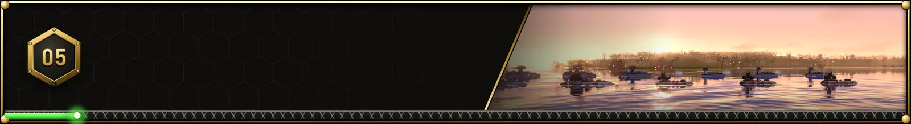</p>

<table>
  <tr>
    <td width="50%" align="center"><br><sub><b>Skirmish</b>: up to ten players in teams on every map of your install</sub></td>
    <td width="50%" align="center"><br><sub><b>The campaigns</b>, briefed as TA gave them: an incoming transmission</sub></td>
  </tr>
  <tr>
    <td align="center"><br><sub><b>Conquest</b>: take a galaxy of TA's worlds system by system</sub></td>
    <td align="center"><br><sub><b>Scenarios</b>: thirteen battles with goals of their own</sub></td>
  </tr>
  <tr>
    <td align="center"><br><sub><b>The debrief</b>: what decided the battle, your figures, your best unit, its key moments</sub></td>
    <td align="center"><br><sub><b>The cast view</b>: replays as a tournament's broadcast</sub></td>
  </tr>
</table>

| Mode | What it is |
| --- | --- |
| **Skirmish** | Up to ten players in teams (free for all, you against all, two teams, or your own), computer players at three levels, starting rules, mutators, TA's line of sight choices |
| **Campaigns** | Every campaign of your install (Arm and Core, The Core Contingency's, Battle Tactics'), with TA's own mission scripts and briefings |
| **Conquest** | A galaxy of TA's worlds taken system by system: rewards for every system held, counter-attacks to beat off, veterans carried from battle to battle, and a Commander who earns perks at each promotion |
| **Scenarios** | Last Stand, King of the Hill, Extraction, Decapitation, Doomsday Clock, Metal Rush, Armageddon, Endless Siege, Until Dawn, Titans, Iron Rain, The Armistice and Brothers in Arms, on three difficulties; your own as TOML files |
| **Multiplayer** | Lockstep over a local network or the internet: a lobby, spectators, chat, rejoining, an ally taking over a lost player's army |
| **Replays** | Every game recorded: seek backwards and forwards, rewind, watch it as a cast, see its highlights, or **export it as an MP4** (720p to 4K, 30 or 60 a second, the director's camera or a cinematic one, with the battle's sounds and music); EXPORT CLIP cuts its best 30 or 60 seconds into a clip for social media, vertical or horizontal, titled and framed for the shape |
| **Tutorial** | Five short lessons, each step spoken aloud in thirteen languages, and field notes on the loading screen |

After a battle, **its highlights** replay its decisive moments with a circling camera and slow
motion; WATCH HIGHLIGHTS is a click away on the result page.

<br>

<a id="computer-players"></a>
<p align="center">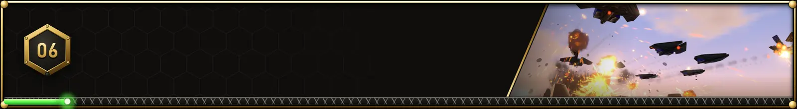</p>

<p align="center">
  
</p>

The computer players run their economies and tech, build defences, raid, send attack waves, air
strikes and nukes, fight at sea and ferry armies across the water. Hard pulls hurt units back for
repairs, concentrates its fire and fights island wars from the air.

They play fair: a computer player knows only what a player in its seat could. It sees what its
team's units see, takes a radar blip for no more than a blip, and remembers your buildings as it
last saw them. It starts from the map's start positions, as you do from the lobby, sends a scout
(or a scout plane, across water) to find your base, and plans its war from what it finds.

They also talk, in person. Each enemy is a persona with a name and a title (an Arm field commander, a
Core machine intelligence, a mercenary), and their lines come in as transmissions: their Commander
on a little screen, static as the link is made, the words typed out as they speak. They greet you,
taunt you, answer what you ask on the chat line, gloat and grumble as the battle turns, mourn their
experimentals, make a last stand when their factories fall, and remember you: an enemy Commander you
have fought before may come back, and greets you by who won last time.

Cheats work in single player: TA's codes (`+atm`, `+nowisee`, `+radar`…) and new ones (`+god`,
`+instant`, `+spawn peewee 10 enemy`), with a panel that places any unit anywhere. A cheat costs the
battle its career: its XP, records and achievements are taken back.

<br>

<a id="the-launcher"></a>
<p align="center">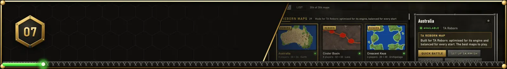</p>

<p align="center">
  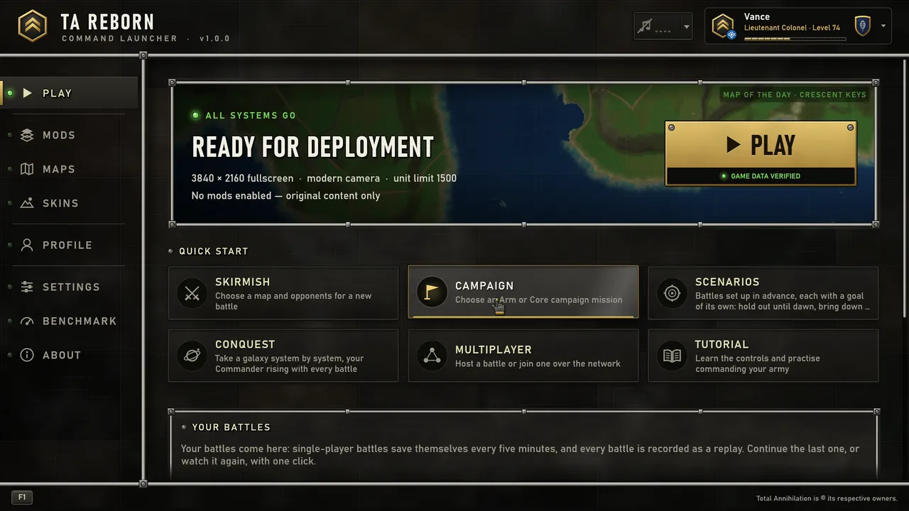
</p>

The launcher finds your GOG or Steam copy by itself (or point it at the game's folder), checks what
is there, sets the graphics up for your computer, and keeps TA Reborn up to date. Its Play page is a
command deck: the game's state at a glance, PLAY, a quick start for every way to play, and your
battles to continue or watch.

<table>
  <tr>
    <td width="50%" align="center"><br><sub><b>Mods</b>: ModDB's conversions in one library, a click to install</sub></td>
    <td width="50%" align="center"><br><sub><b>Maps</b>: every map with a picture of its own terrain</sub></td>
  </tr>
  <tr>
    <td align="center"><br><sub><b>Skins</b>: nineteen skins and an editor for your own</sub></td>
    <td align="center"><br><sub><b>Your career</b>: profiles, XP, ranks and achievements</sub></td>
  </tr>
</table>

- **Mods**: the catalogue's community conversions (TA: Escalation, Total Mayhem, Talon, Total
  Battletech, The Final Frontier and more) and your installed mods in one library: search, filter,
  install in a click, update all; see what each mod changes; drag the load order into place; hide
  the catalogue's mods you never want to see. Every mod is checked in the background against the
  game without it, so what it breaks counts and what was broken before does not. A right-click on
  any card or row of the Mods, Maps and Skins libraries opens what can be done with it.
- **Maps**: cards with each map's own terrain, filters by players, size, world and source,
  favourites, a random pick; details with the numbered start positions, PLAY, SET UP SKIRMISH and
  EDIT A COPY; map archives imported in a click.
- **Skins**: every skin on your units; use it for your army or the enemy; **make your own** in the
  editor (a pattern from tiles in your colours, palettes, finish and weathering, pictures of your
  own on the armour, all live, with undo) and share `.taskin` packs ([guide](docs/UNIT_SKINS.md)).
- **Commander profiles**: several people on one device, each with their own settings, saves,
  campaign progress and career. Playing earns XP for time, kills, units and buildings, captures,
  economy and results; **twenty-one ranks** from Recruit to Commander, each with its insignia, and
  service stars past level 100. **134 achievements** in six categories and four tiers, each with
  its own medallion, a notice when earned and a picture of the moment kept for its page
  ([catalogue](docs/ACHIEVEMENTS.md)).
- **Benchmark**: eight staged scenes on TA Reborn's own worlds, up to twenty thousand units at once,
  and two tests: the settings, and what each effect costs. Scores for your graphics card, processor
  and memory against an RTX 4080 with a Ryzen 9 5950X (10,000 each), and the settings that hold 60
  frames a second; a quick run takes about a minute and a half.
- **And**: quick starts for skirmish, campaign, tutorial and the map editor; your recent saves and
  replays, each naming the mods it needs; TA's calmer music playing quietly; seasonal dress at
  Halloween, Christmas and the New Year; brass pointers that breathe; keyboard help on F1 and
  search on Ctrl+F; an About page with the credits and the way to the website.

<br>

<a id="worlds"></a>
<p align="center">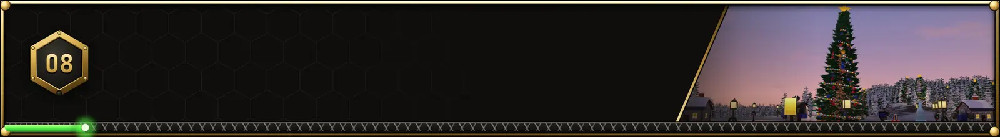</p>

<p align="center">
  
</p>

Twenty-nine maps of TA Reborn's own, grown by its map generator and shipped with the game. The
duels and team maps are point-symmetric, each half the other turned round the middle; every base
has level ground to build on and its metal close by; and on land maps a tank can drive from every
base to every other. The real places are as they are, their bases at their cities:

| | |
| --- | --- |
| **Forests** | Mossvale, Timberline, Greenmantle, and Highland Rift's river canyon |
| **Deserts** | Sunscar Dunes, Redstone Mesas, Mirage Basin |
| **Islands** | Twin Reefs, Crescent Keys, Stormbreak Archipelago, Sapphire Reach, and Shore to Shore Reborn's two coasts across a wide ocean |
| **Fire** | Embergate, Furnace Caldera, Obsidian Wastes, Cinder Basin's molten rivers |
| **Metal** | Foundry Deck, Reactor Grid, Hammerfall Works: decks of plating over coolant canals |
| **Space** | Rift Belt, Lagrange Station, Starfall Expanse: rocks adrift over a planet, joined by gantries |
| **Winter** | Frostfall Hollow, Hollyridge, Midnight Square, First Light Peaks: villages lit by night, fireworks at New Year |
| **Real places** | Australia, the United States and the whole world, their coasts and lakes from Natural Earth |

<table>
  <tr>
    <td width="50%" align="center"><br><sub><b>Australia</b>, 28 x 24 for eight players, alone in its ocean</sub></td>
    <td width="50%" align="center"><br><sub><b>Lagrange Station</b>: six rocks round a station, a planet far below</sub></td>
  </tr>
  <tr>
    <td align="center"><br><sub><b>Hollyridge at Christmas</b>: the great fir lights up at dusk</sub></td>
    <td align="center"><br><sub><b>Midnight Square</b>: a truce under the fireworks</sub></td>
  </tr>
</table>

<br>

<a id="the-archives"></a>
<p align="center">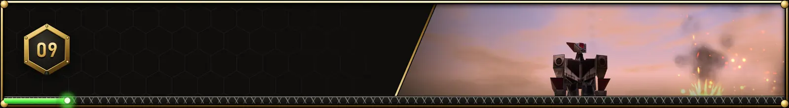</p>

<table>
  <tr>
    <td width="50%" align="center"><br><sub><b>Every unit</b>, mods' too, standing, moving or firing in a world of your choosing; wallpapers up to 8K</sub></td>
    <td width="50%" align="center">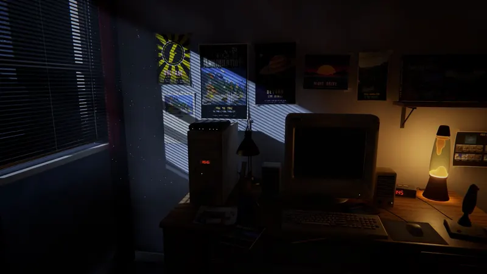<br><sub><b>The intro's room</b>: a 19-inch CRT, late at night in 1997, where TA's intro plays</sub></td>
  </tr>
  <tr>
    <td align="center"><br><sub><b>The title screen</b> films TA Reborn's worlds behind it, a scene at a time</sub></td>
    <td align="center"><br><sub><b>The Galactic War</b>: the war's chronicle over a living galaxy, its archive, every campaign</sub></td>
  </tr>
</table>

<p align="center">
  <br>
  <sub><b>The credits</b>, timed to "The War Reborn": Battle Tactics' team burns in on the drop</sub>
</p>

- **The encyclopaedia** lists every unit by side and kind, in its side's colours, beside everything
  TA's F1 page tells and the build chain that makes it; WALLPAPER saves the very picture you frame.
- **The intro's room** is a modelled bedroom lit by the moon through the blinds. The camera comes in
  to the desk as the CRT warms up and degausses, and the movies light the room in their colours. On
  the desk: a lava lamp, a modem blinking on the tower, a turbo display reading 166, a flight stick,
  and a battle planned in pen on a print of one of your maps. It follows the launcher's seasonal
  setting: through December a little tree twinkles on the speaker, with presents, fairy lights, a
  stocking and snow at the window; on New Year's Eve and Day the room holds a party, with balloons,
  streamers, a banner and fireworks over the street.
- **The Galactic War** tells TA's story in twelve chapters of its own. Each plays over a painting of
  the galaxy as it stood then: CORE's worlds in the middle, the ARM's rim, the front, burned worlds,
  fleets under way. The galaxy eases from chapter to chapter as the text is typed out, or plays
  through as a film. Its archive holds documents from both sides: CORE's edict, the ARM's
  declaration, a clone trooper's letter home, an intercepted signal, the Krogoth's threat
  assessment. Every campaign's missions lie on their worlds, ready to play.
- **The title screen** is a film of short scenes staged live on TA Reborn's worlds, each with its own
  light, weather and camera; leave it a while (or press WATCH) and the menu steps aside for it.
- **The credits** are a film timed to their own song, Hadal Static's "The War Reborn": a battle
  across six worlds in which the names (Cavedog's teams, read from your install, and TA Reborn's)
  lie on the ground, burn, are projected or built, each card on a bar of the music, the acts on its
  sections, a nuke on its loudest bar.
- **A jukebox** for TA's soundtrack by its parts and your own music beside it; TA's own interface
  sounds.
- **Fourteen languages**: English, German, French, Spanish, Italian, Brazilian Portuguese, Polish,
  Russian, Ukrainian, Turkish, Japanese, Korean, and Simplified and Traditional Chinese.

<br>

<a id="mods"></a>
<p align="center">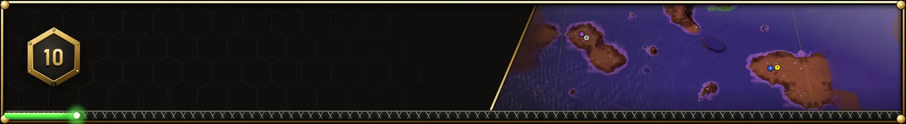</p>

https://github.com/user-attachments/assets/0c29747c-1139-4f19-877a-3661836a55c5

<p align="center"><sub>Mod support, filmed in the game: TA: Escalation, Total Mayhem and TA: Enhanced, each installed by the launcher. The mods are their teams' work: the TA: Escalation Mod Group, Mayhem Inc and Firmament.</sub></p>

<table>
  <tr>
    <td width="50%" align="center"><br><sub><b>The map editor</b>: shape the ground, paint, place features and starts, test-play</sub></td>
    <td width="50%" align="center"><br><sub><b>F1 on any unit</b>: everything TA's data says about it, mods' units too</sub></td>
  </tr>
</table>

- **Mods need no code**: they load from folders or TA's own archives, later ones over earlier ones,
  and the rules and the computer players read unit properties. A mod's archive named like one of
  the game's takes its place, as installing it in TA's folder did. Mods made for patched original
  engines can load their own sides.
- **The big conversions play**: TA: Escalation, Total Mayhem and TA: Enhanced install from the
  launcher (or from the file you downloaded) and play with all their units: painted however many
  textures they bring, their walkers and turrets moving as their scripts tell them, their missiles
  guided, their nukes nuclear.
- **Saved games and replays remember their mods**: each keeps the mods it was played with, by name,
  version and contents. The lists say what a battle needs; opening one whose mods are missing, off
  or changed offers to turn them on, to get them in the launcher, or to load it anyway.
- **Every mod is checked** for its files, references, sounds and packaging, against the game without
  it; a readable report says where and how to fix it ([MOD_VALIDATION.md](docs/MOD_VALIDATION.md),
  or `ta-tools validate-mod` for a mod's own build).
- **The map editor** works on new maps or copies of existing ones: tools by name, a status bar, the
  map in miniature, a check for problems and TEST PLAY; it takes your pictures as heights, art or
  tile brushes, shows features as pictures and scatters them, and saves maps as mods the skirmish
  page lists at once.
- **`ta-tools`** inspects, converts and validates TA's data files (`validate`, `map`, `gaf`, `model`,
  `cob`, `cat`, `find`…), and grows TA Reborn's maps (`mapgen`; [MAPS.md](docs/MAPS.md)).

<br>

<a id="get-started"></a>
<p align="center">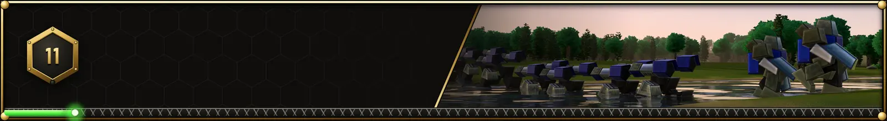</p>

1. **Own Total Annihilation.** The Commander Pack (with The Core Contingency and Battle Tactics),
   from GOG or from Steam: both ship the same data files. Other copies work too.
2. **Download TA Reborn** from [Releases](https://github.com/Jared-woodruff/TA-Reborn/releases/latest):
   **x64** or **ARM64**. Windows has an installer and a portable ZIP; macOS an app ZIP and DMG; Linux
   Ubuntu DEB, Arch / Arch Linux ARM and portable packages.
3. **Start TA Reborn.** The launcher finds GOG and Steam installs by itself, checks what is there and
   sets the graphics up for your computer. Create your commander profile (a name, a picture and an
   allegiance) and press PLAY.
4. **Run the benchmark** (optional) from the BENCHMARK page for the settings that suit your computer.

| | Needs | Best with |
| --- | --- | --- |
| **Systems** | Windows 10+ x64 / Windows 11 ARM64; macOS 13+ Intel or Apple Silicon; Ubuntu 22.04+ / Arch Linux x64 / Arch Linux ARM | |
| **Graphics** | DirectX 12 or Vulkan on Windows, Vulkan on Linux, Metal on macOS; integrated graphics on Low | 6 GB of video memory for High, 10 GB for Ultra; a card that traces rays for ray tracing |
| **The game** | Total Annihilation, legitimately owned | The Commander Pack, both expansions |

> [!NOTE]
> This page shows the current development build. The latest release is
> [1.0.0](https://github.com/Jared-woodruff/TA-Reborn/releases/latest); [CHANGELOG.md](CHANGELOG.md)
> says what each release brought.

Settings, mods, skins and downloads live in `%APPDATA%\TA Reborn` (each commander's own below
`profiles\<id>`); screenshots and photos in `Pictures\TA Reborn`; videos made from replays in
`Videos\TA Reborn`. See the [release and platform guide](docs/RELEASING.md) for packages and the
[profile and Maps guide](docs/LAUNCHER_MAPS_CAREER.md) for the launcher's pages.

<br>

<a id="build"></a>
<p align="center">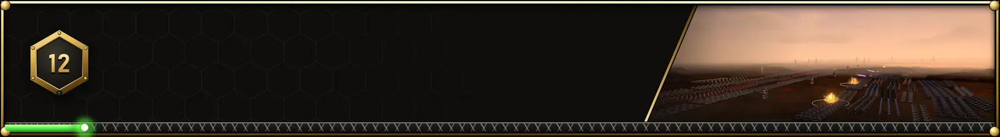</p>

With [Rust](https://rustup.rs) 1.95 or newer and the game installed:

```bash
cargo run --release -p ta_game -- --map "Coast To Coast"
```

```bash
cargo run --release -p ta_launcher
```

```bash
cargo test --release --workspace --locked
```

The tests that read game data skip themselves when no install is found; `ta_formats` writes and
re-reads every map of the install. The Windows installer is built with
`powershell -ExecutionPolicy Bypass -File installer\build_installer.ps1` (needs
[NSIS 3](https://nsis.sourceforge.io); see [installer/README.md](installer/README.md)); native Linux and
macOS packages with `installer/build_linux.sh` and `installer/build_macos.sh`. The
[release guide](docs/RELEASING.md) covers all six targets.

<details>
<summary><b>Handy flags for development</b></summary>

| Flag | What it does |
| --- | --- |
| `--map "<name>"` | Straight into a skirmish on that map |
| `--profile <id>` | Launch under a specific commander profile |
| `--classic` | TA's 1997 oblique view instead of the free camera |
| `--mission "arm campaign:0"` | Straight into a campaign mission |
| `--scenario last-stand` | Straight into a scenario |
| `--host PORT` / `--join ADDR` | The multiplayer lobby |
| `--replay x.tarep` / `--load x.tasav` | Watch a replay, continue a saved game |
| `--editor ["<map>"]` | The map editor on a copy of that map, or a new one |
| `--demo battle\|nuke\|naval\|swarm\|perspective\|stage` | Scripted scenes for captures and testing |
| `--screenshot out.png --frames N` | Capture after N frames, then exit (`TA_SHOTS=n` films a strip) |

</details>

<br>

<a id="under-the-hood"></a>
<p align="center">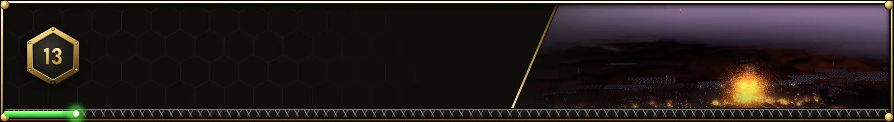</p>

The simulation runs at TA's 30 ticks a second in fixed-point arithmetic, with table trigonometry and
its own random numbers, so every computer playing a game computes the same battle: that is what
lockstep multiplayer, replays and rewinding stand on. TA's own unit scripts (COB) run in a virtual
machine inside it, and the computer players give the same orders a player does. It is 64-bit
throughout, with room to grow for mods: maps up to 16,384 cells a side, 256 unit categories, 64
players inside the game, and build times exact however long.

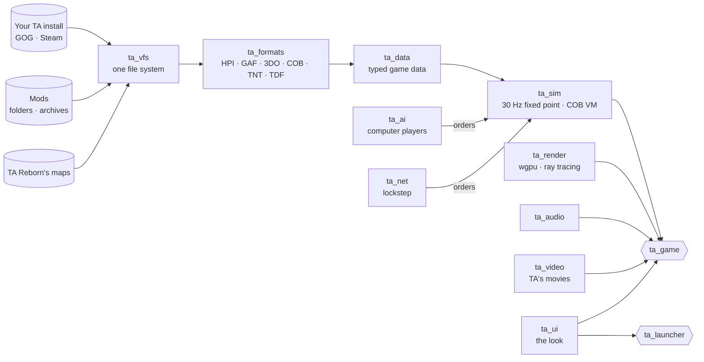

| Folder | What it is |
| --- | --- |
| `crates/ta_formats` | TA's file formats: HPI archives, GAF, 3DO, COB, TNT, TDF, PCX… |
| `crates/ta_vfs` | Finds the install (GOG, Steam or a folder), mounts the archives, TA Reborn's maps and the mods as one file system |
| `crates/ta_data`, `ta_sim` | Game data, and the deterministic 30 Hz simulation with the COB script VM |
| `crates/ta_ai` | The computer players |
| `crates/ta_render`, `ta_audio`, `ta_video` | The wgpu renderer, sound and music, TA's movies |
| `crates/ta_net`, `ta_config`, `ta_ui`, `ta_skins`, `ta_mp4` | Lockstep multiplayer, settings and careers, the shared interface, unit skins, video export |
| `apps/ta_game`, `ta_launcher`, `ta_tools` | The game, the launcher, the data tools and map generator |

[docs/ARCHITECTURE.md](docs/ARCHITECTURE.md) explains how it all works,
[docs/FORMATS.md](docs/FORMATS.md) the verified facts about TA's formats, and
[docs/ROADMAP.md](docs/ROADMAP.md) what is done and what is open.

<br>

<a id="credits"></a>
<p align="center">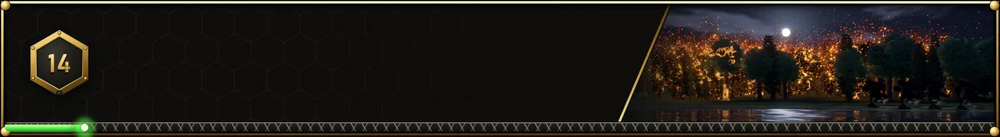</p>

- **Project Lead:** Jared Woodruff ([github.com/Jared-woodruff](https://github.com/Jared-woodruff))
- **DEV:** Claude Opus 5.5 by Anthropic
- **QA:** GPT6 Astra by OpenAI
- **VO:** Kokoro-82M by Hexgrad
- **VO:** Chatterbox by Resemble AI
- **Website:** [ta-reborn.com](https://ta-reborn.com/)
- **Built with:** Rust, wgpu, winit, egui and eframe, symphonia, cpal, glam, rayon, serde and the
  other libraries listed in `THIRD-PARTY-NOTICES.txt`; the original art made with Blender and Python
  (NumPy, Pillow), its models packed with gltfpack; the installer built with NSIS
- **Map data:** coastlines and lakes from [Natural Earth](https://www.naturalearthdata.com)
- **Music:** "The War Reborn" by Hadal Static, the credits' song (and the launch trailer's), used
  with permission
- **Thanks:** the Total Annihilation community, whose decades of file-format research made this
  possible, and everyone who has kept Total Annihilation alive since 1997
- **Total Annihilation:** Cavedog Entertainment, 1997. The game's credits name its teams, read from
  your install

Copyright © 2026 TA Reborn contributors. TA Reborn is free software: you can redistribute it and/or
modify it under the terms of the [GNU General Public License](LICENSE) as published by the Free
Software Foundation, either version 3 of the License, or (at your option) any later version. It is
distributed in the hope that it will be useful, but without any warranty; see the licence for
details. Contributions are accepted under the same terms. The third-party libraries it is built
with keep their own licences; the release
packages list them in `THIRD-PARTY-NOTICES.txt` (`ta-tools notices` writes it).

The music of the credits, "The War Reborn" by Hadal Static, is © Hadal Static, all rights
reserved, and is used with permission: it is not covered by the GPL
(`assets/reborn/music/NOTICE.txt`).

Total Annihilation is © its respective owners. TA Reborn is an unofficial fan project, not
affiliated with or endorsed by them. The pictures on this page are of TA Reborn playing the original
game's data from a legitimately owned copy.

<p align="center"></p>
