<p align="center">
  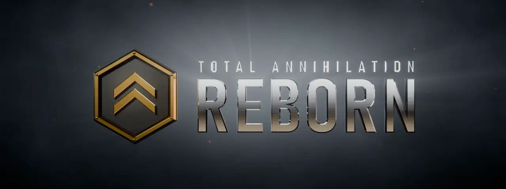
</p>

<h1 align="center">The war you remember. The way you imagined it.</h1>

<p align="center">
  <b>Total Annihilation</b> rewrote the strategy game in 1997. <b>TA Reborn</b> is a new engine for it, written from nothing in Rust.<br>
  Point it at the copy you own, and the same units, maps and campaigns fight in a lit, living 3D world:
  twenty thousand units in one battle, a cockpit in every one of them, and the community's mods a click away.
</p>

<p align="center">
  <a href="https://github.com/Jared-woodruff/TA-Reborn/releases/latest">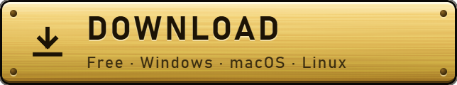</a>
  &nbsp;
  <a href="#trailer">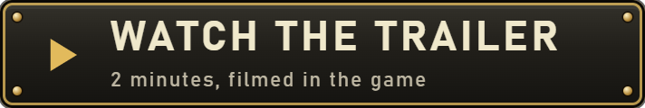</a>
  &nbsp;
  <a href="https://ta-reborn.com/">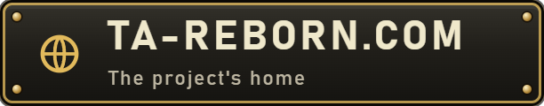</a>
</p>

<p align="center">
  <a href="https://github.com/Jared-woodruff/TA-Reborn/releases/latest"></a>
  
  
  <a href="#credits"></a>
  
</p>

<a id="trailer"></a>

https://github.com/user-attachments/assets/231fbe92-a6bd-4ff5-bea5-b6174d606288

<p align="center"><sub>The 1.0 launch trailer, filmed in the game. Its music, “The War Reborn” by Hadal Static, is an original track made for TA Reborn.</sub></p>

> [!IMPORTANT]
> **Bring your own copy.** TA Reborn contains no original game data: no units, maps, art, sound,
> music or video. It plays a legitimately owned copy of Total Annihilation, such as the
> *Commander Pack* on [GOG.com](https://www.gog.com/game/total_annihilation_commander_pack) or
> [Steam](https://store.steampowered.com/app/298030/), read in place from where you installed it.
> It is an unofficial fan project, not affiliated with or endorsed by the game's owners.

<p align="center">
  <b>
    <a href="#the-battlefield">Battlefield</a> ·
    <a href="#construction">Construction</a> ·
    <a href="#perspective">Perspective</a> ·
    <a href="#command">Command</a> ·
    <a href="#ways-to-play">Ways to play</a> ·
    <a href="#the-launcher">Launcher</a> ·
    <a href="#worlds">Worlds</a> ·
    <a href="#mods">Mods</a> ·
    <a href="#the-archives">Archives</a> ·
    <a href="#get-started">Get started</a> ·
    <a href="#faq">FAQ</a> ·
    <a href="#build">Build</a>
  </b>
</p>

<a id="then-and-now"></a>

## One battle, two eras

<p align="center">
  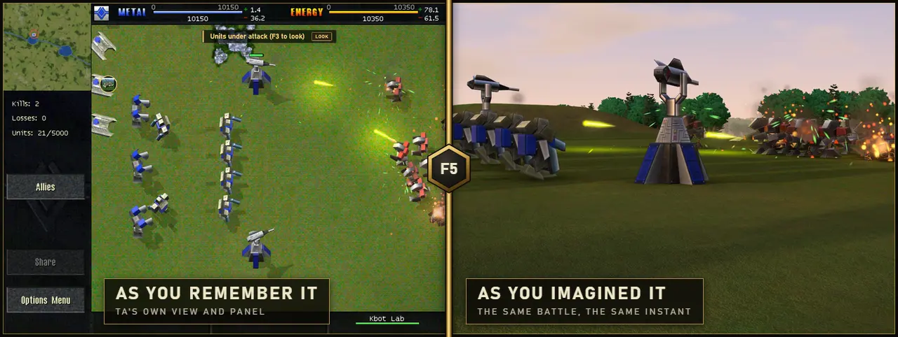
</p>

That is **one battle, simulated once and drawn twice**. On the left, Total Annihilation as it has
looked since 1997: its own top-down view and its own panel. Both are still in TA Reborn, a key and
a setting away. On the right, the same instant through TA Reborn's camera.

TA Reborn replaces the engine and nothing else. It reads the game's archives where you installed
them and plays what is in them: every unit by its own script, every map, every campaign mission,
every sound. Everything round them is new.

<p align="center">
  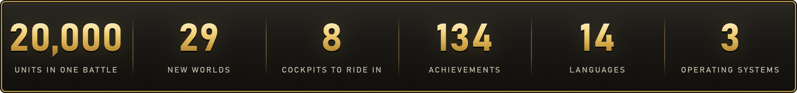
</p>

<a id="features"></a>

## Everything at a glance

<table>
  <tr>
    <td width="33%"><a href="#the-battlefield">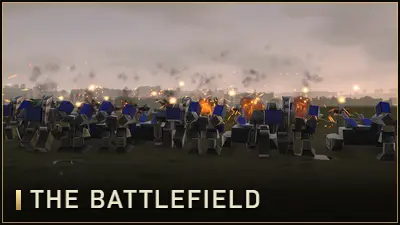</a></td>
    <td width="33%"><a href="#the-battlefield">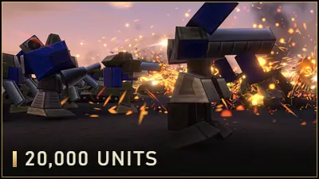</a></td>
    <td width="33%"><a href="#the-battlefield">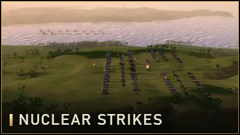</a></td>
  </tr>
  <tr>
    <td><a href="#construction">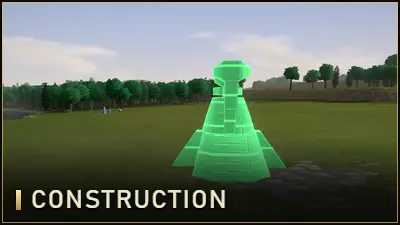</a></td>
    <td><a href="#perspective">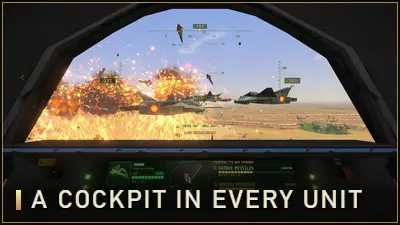</a></td>
    <td><a href="#command">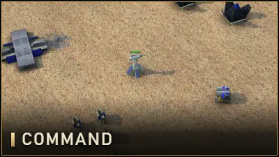</a></td>
  </tr>
  <tr>
    <td><a href="#ways-to-play">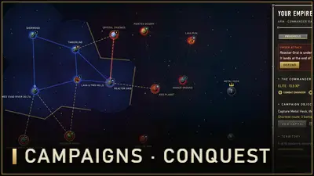</a></td>
    <td><a href="#ways-to-play">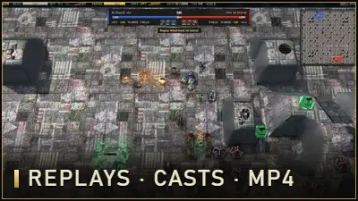</a></td>
    <td><a href="#the-launcher">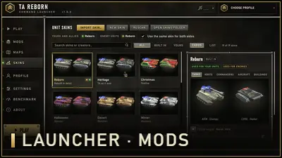</a></td>
  </tr>
  <tr>
    <td><a href="#worlds">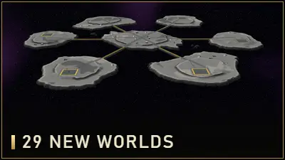</a></td>
    <td><a href="#the-battlefield">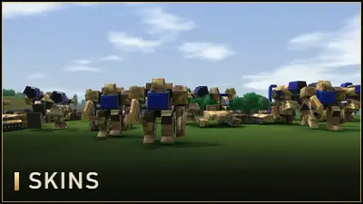</a></td>
    <td><a href="#the-archives">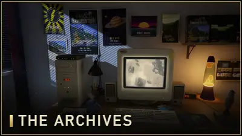</a></td>
  </tr>
</table>

<p align="center"><sub>Every tile is the game itself, and a link to its chapter.</sub></p>

<br>

<a id="the-battlefield"></a>
<p align="center">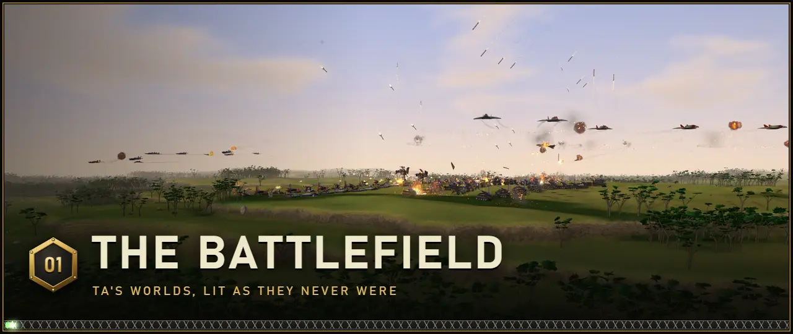</p>

Every world has a sky and a light of its own. Hills throw long shadows and steep faces stand as
walls of rock. Surf breaks on the shores and ships leave wakes. Lava crusts over and glows through
its cracks. Rain soaks the ground and stands in puddles that mirror the sky. And from TA's usual
height, the battle keeps the art exactly as it was painted.

<table>
  <tr>
    <td width="50%" align="center">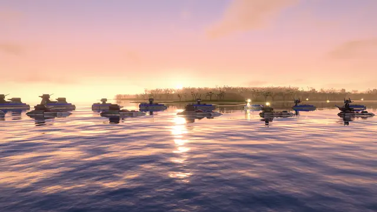<br><sub><b>War at sea</b>: bow waves, wakes, hulls seen through the water</sub></td>
    <td width="50%" align="center">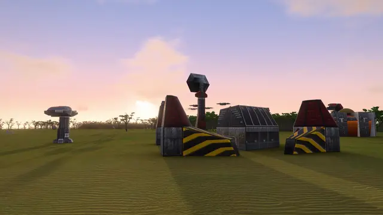<br><sub><b>The air war</b>: Thunders out of the setting sun</sub></td>
  </tr>
  <tr>
    <td align="center">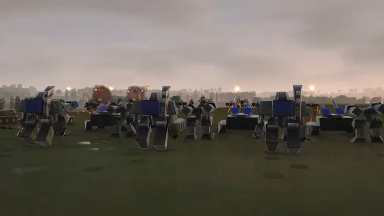<br><sub><b>Weather</b>: showers that soak the ground and dry after</sub></td>
    <td align="center">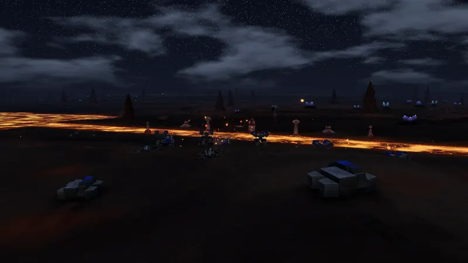<br><sub><b>Lava worlds</b>: the melt lights the rock</sub></td>
  </tr>
  <tr>
    <td align="center">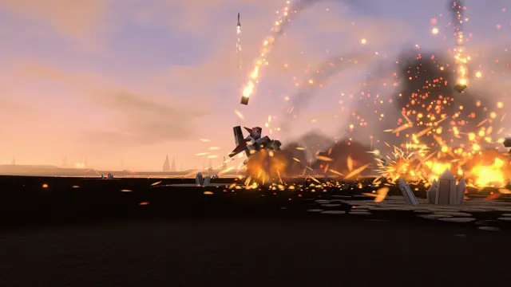<br><sub><b>Experimentals</b>: a Krogoth walks out of the dusk</sub></td>
    <td align="center">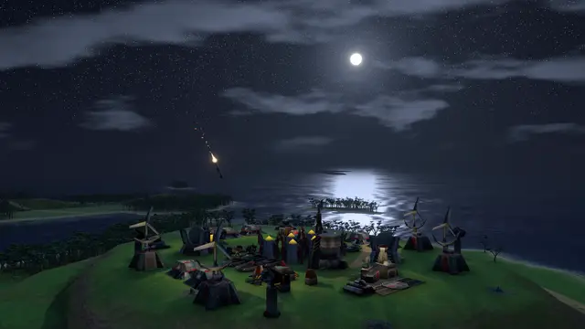<br><sub><b>Nuclear strikes</b>: the flash, the shockwave, the fireball</sub></td>
  </tr>
</table>

<p align="center">
  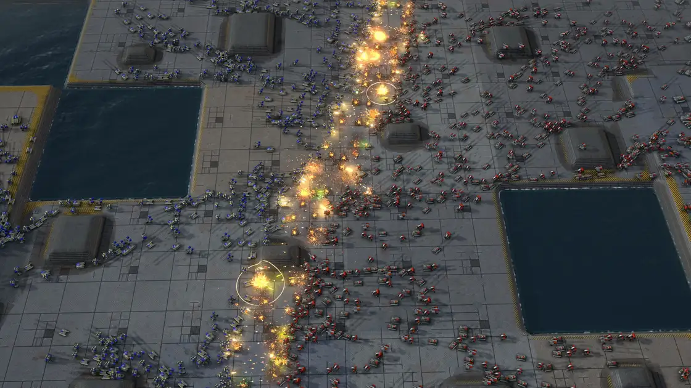
  <br><sub><b>Twenty thousand units, one battle.</b> The camera pulls back from two of them until their front is a seam of fire across the map</sub>
</p>

<p align="center">
  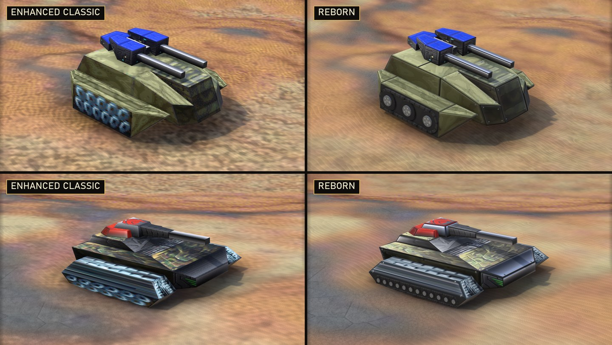
  <br><sub><b>Two art styles</b>: Enhanced Classic keeps TA's own models and paint; Reborn rebuilds every unit, mods' too, with armour plates, bolts and road wheels</sub>
</p>

<details>
<summary><b>More about the battlefield</b>: the renderer, water, time and weather, weight, skins</summary>

<br>

<table>
  <tr>
    <td width="50%" align="center">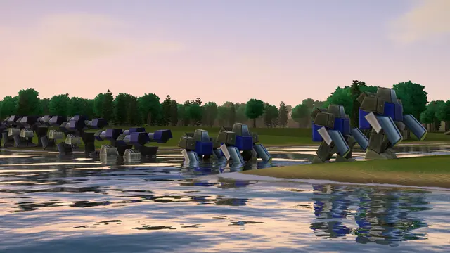<br><sub><b>Time of day</b>: an Arm column fords the river at first light</sub></td>
    <td width="50%" align="center">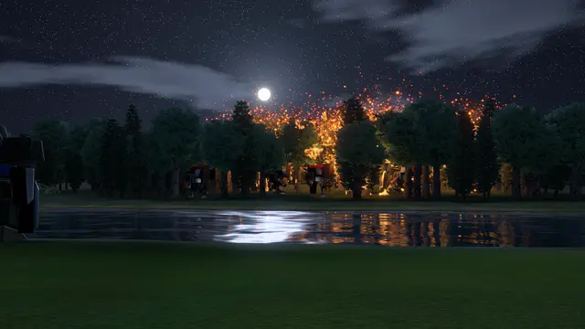<br><sub><b>Fire</b>: a wood burning under the hunter's moon</sub></td>
  </tr>
</table>

- **A modern renderer for TA's art**: physically based lighting, soft shadows that harden at the
  contact, ambient occlusion, HD surfaces that wear paint, soot and embers, and the ground's own
  materials (sand, soil, turf, rock, snow, ice, volcanic rock, metal, lunar dust) told from TA's
  painted colours. On cards that trace rays: ray-traced shadows, occlusion and reflections.
- **Worlds of their own**: smoke over lava, smog over metal and cities, violet over crystal, a black,
  starry sky on the moon; dull worlds graded as their painters meant them. Beyond the map's edge
  the world runs on: the map's own ground across the edge, then land and sea like the map's round
  that stretch of it (a metal world's city of plating, the moon's craters), never copies of it.
- **Water**: surf and whitecaps, shallows graded by depth with caustics on the bed, bow waves and
  wakes behind ships and hovercraft, hulls and wading legs seen through the water. Lava crusts and
  glows; acid looks like acid.
- **Time and weather**: dawn, dusk, a moonlit night (bases light up, aircraft blink their beacons)
  or a full day and night; showers that soak the ground and dry; the wind across the land, gusts
  running over the grass in soft cat's paws, sand streaming and snow drifting the way it blows.
- **Battles with weight**: vehicles squat, dip and lean on their suspension; guns kick their units
  back and big blasts shove the units round them; walkers walk in step with the ground and leave
  footprints the shape of their feet; aircraft fall trailing smoke; ships list and go under;
  shells landing in the sea throw up spray.
- **3D close to the ground**: TA's painted trees, rocks, crystals, ruins, pipework and relays stand
  as models of TA Reborn's own when the camera comes down to them.
- **Skins**: nineteen built in (Reborn's own; Heritage's battle-worn TA as it was; desert, winter,
  woodland, navy, urban, tiger and night camouflage; Christmas, Halloween and parade dress; and the
  colours of seven nations), for your army, the enemy or both, and an editor to make your own.

</details>

<br>

<a id="construction"></a>
<p align="center">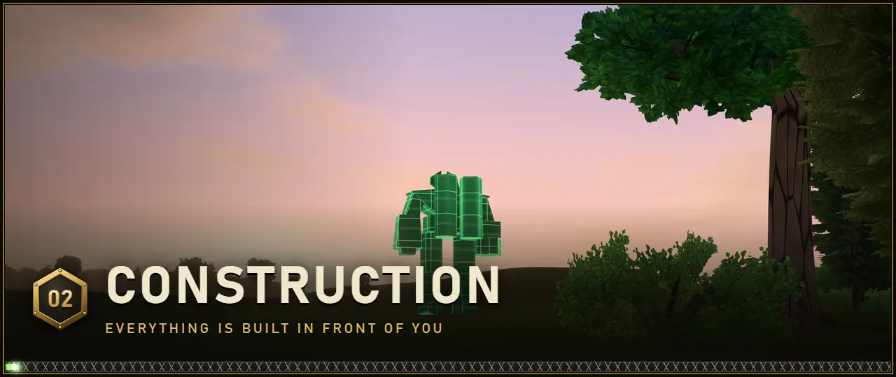</p>

Everything is built the way TA built it: a constructor plays its nano-lathe on the ground, a green
lattice rises out of the beams and fills in, and the finished building unfolds. Here the beams are
streams of light that arc and splash, wrecks are reclaimed into metal, and a destroyed building
sags into its rubble.

<p align="center">
  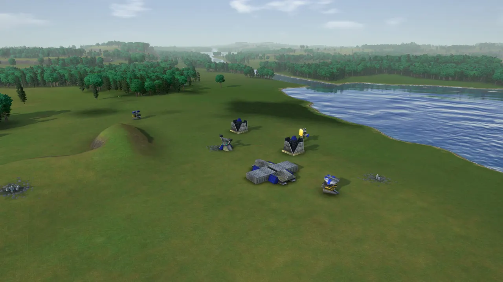
  <br><sub><b>A morning in a few seconds</b>: a base rising on Highland Rift, eight times as fast</sub>
</p>

<table>
  <tr>
    <td width="50%" align="center">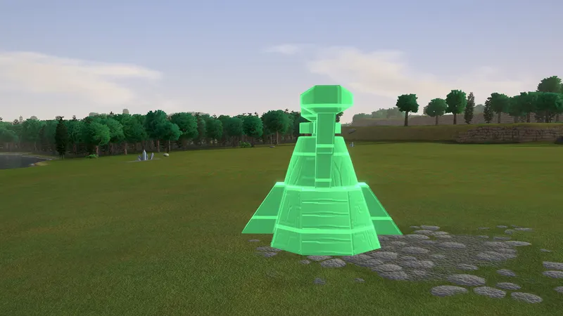<br><sub><b>The first extractor</b> rises on its deposit</sub></td>
    <td width="50%" align="center">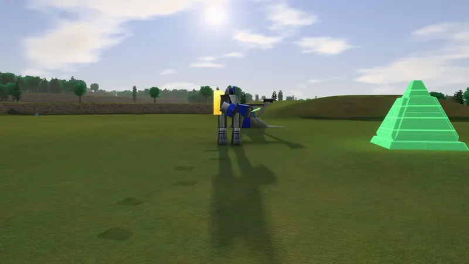<br><sub><b>Solar collectors</b> rise and unfold</sub></td>
  </tr>
  <tr>
    <td align="center">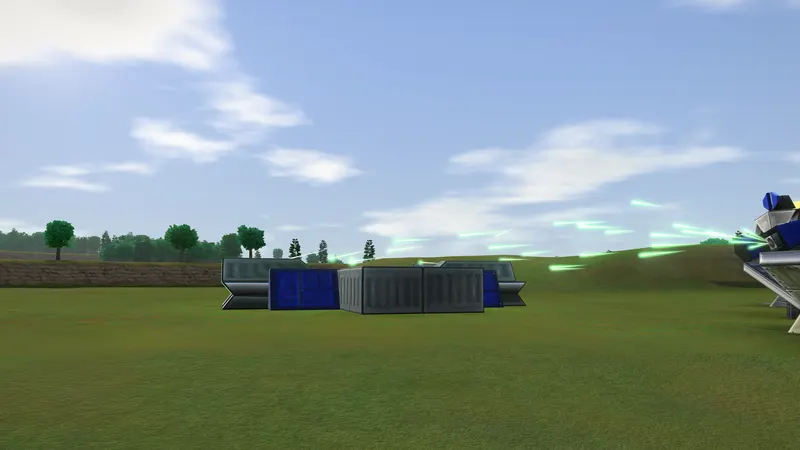<br><sub><b>Factories at work</b>: the lab opens and its first Peewee walks out</sub></td>
    <td align="center">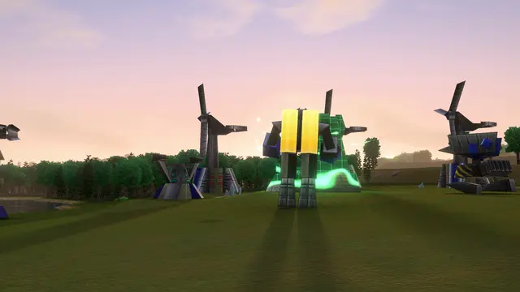<br><sub><b>Building at sunset</b>, the beams green in the low gold light</sub></td>
  </tr>
</table>

<br>

<a id="perspective"></a>
<p align="center">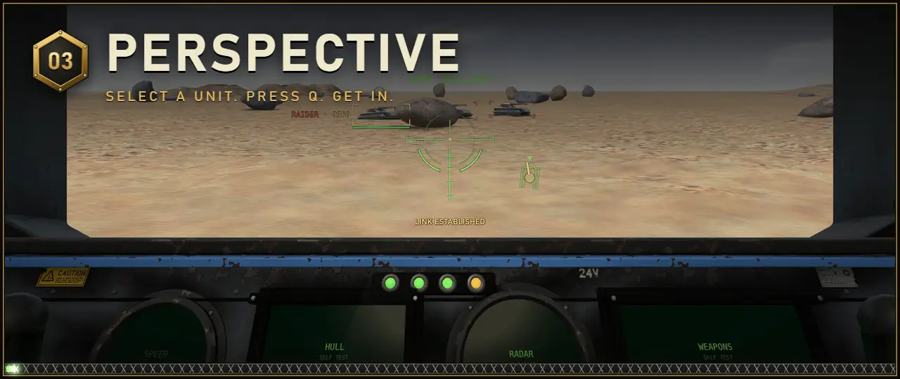</p>

Select a unit and press **Q**. The camera dives into it: onto a tank's turret, into a walker's
head, onto a ship's bridge, up a submarine's periscope, into a fighter's canopy. You ride along
while it goes on with its orders. The mouse looks round, the wheel magnifies the sight, and Escape
climbs back out.

<table>
  <tr>
    <td width="50%" align="center">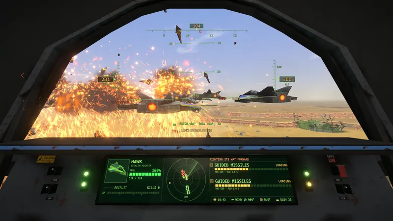<br><sub><b>A fighter's helmet display</b>, banking through a dogfight</sub></td>
    <td width="50%" align="center">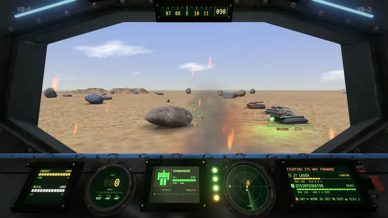<br><sub><b>A walker's HUD</b>: armour by section, torso twist, weapon groups</sub></td>
  </tr>
</table>

<details>
<summary><b>More about the cockpits</b>: eight of them, their instruments, whose units you can ride</summary>

<br>

- **Eight modelled cockpits**, made in Blender for TA Reborn: a tank's vision port, a kbot's visor,
  the Krogoth's heavy cab, the Commander's helmet, a ship's bridge, a fighter's canopy, a gunship's
  glass, a gun house's slit in concrete. Their dashes are worn working metal: chipped paint, stencils,
  caution plates and guarded switches. Glass in every window: dust that catches the sun, and in the
  rain drops that cling and run down it.
- **Instruments for each kind**: a fighter's helmet display (the pitch ladder, the heading tape,
  speed and altitude, the flight path) and a glass panorama in the cockpit; a tank's sight with its
  range finder, ammunition and turret's bearing; a walker's HUD with its armour by section, torso
  twist, throttle and weapon groups. Every cockpit gives its speed in figures, the unit's figures,
  its heading, pitch and roll, and the weather outside; the radar scope and each weapon's reload too.
  One fact in one place: the glass keeps what you aim by, the dash the rest.
- **Yours, an ally's, or anyone's**: ride along with an ally's unit, or any unit in a replay or as a
  spectator. You hear the battle from inside the hull, the glass cracks as it wears, the cabin lamp
  stutters as the hull fails, and a unit lost takes its signal with it.

</details>

<br>

<a id="command"></a>
<p align="center">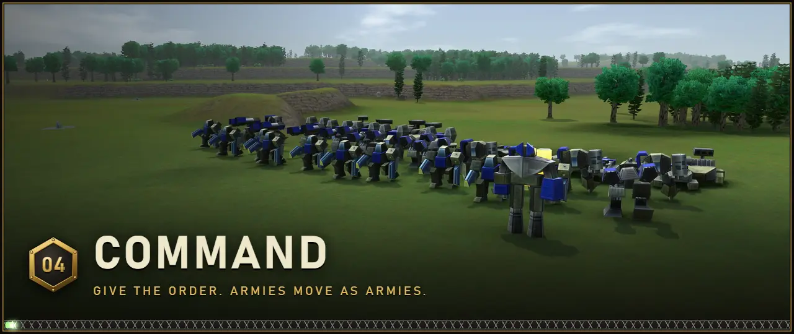</p>

A group sent somewhere forms up, the short-ranged in front, and marches at the pace of its slowest
unit. A right-click on a unit rings its orders round the pointer. A constructor put on duty runs
the economy by itself. And every key, command and habit of TA's is still there.

<p align="center">
  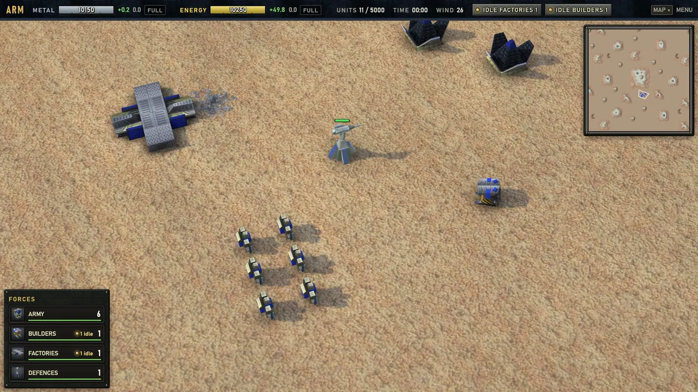
  <br><sub><b>The command deck</b>: the minimap top right, the economy in the top bar, the selection and its orders below; the radial menu on any unit</sub>
</p>

<table>
  <tr>
    <td width="50%" align="center">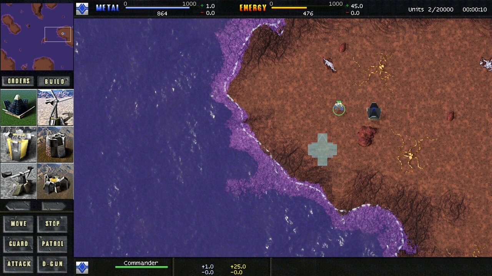<br><sub><b>Or TA's own 1997 interface</b>, in TA's oblique view, crisp at any size</sub></td>
    <td width="50%" align="center">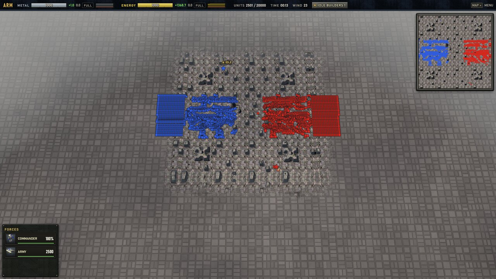<br><sub><b>Strategic zoom</b>: pull back and every unit becomes an icon</sub></td>
  </tr>
  <tr>
    <td align="center">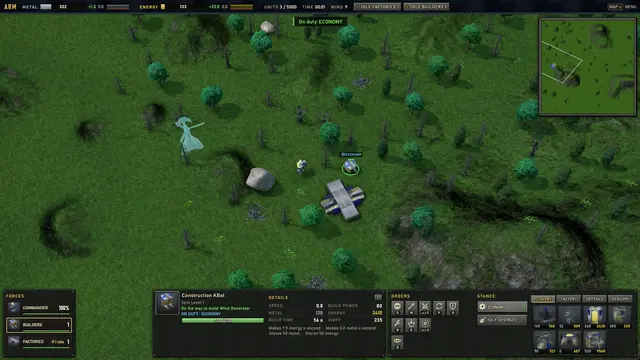<br><sub><b>Duties</b>: a constructor runs the economy, yours again with any order</sub></td>
    <td align="center">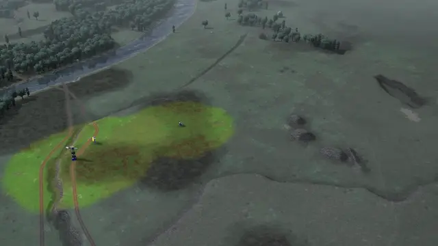<br><sub><b>The fog of war</b>: drifting edges, radar blips, last-known ghosts</sub></td>
  </tr>
  <tr>
    <td align="center">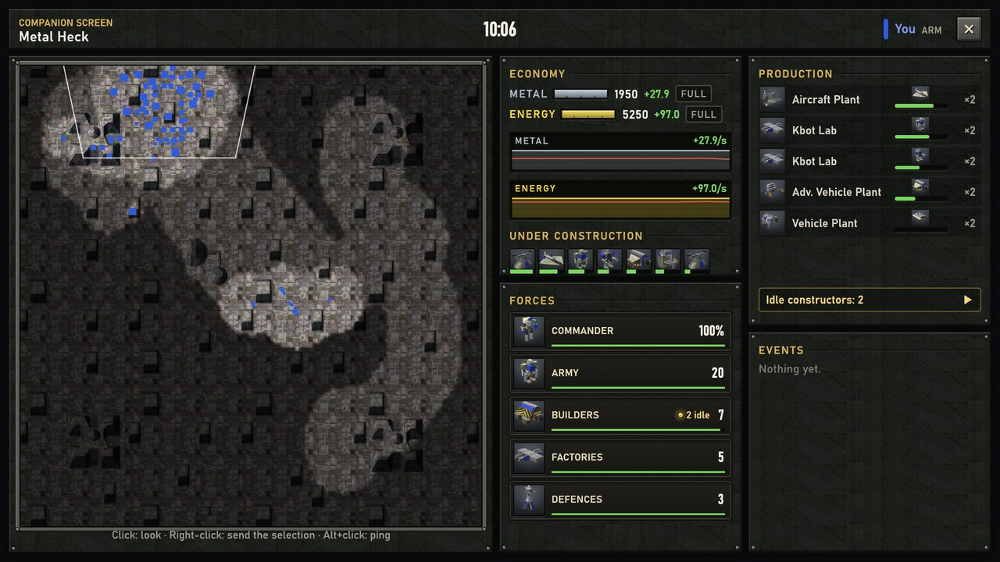<br><sub><b>The companion screen</b> on a second display: the whole map beside your intel</sub></td>
    <td align="center">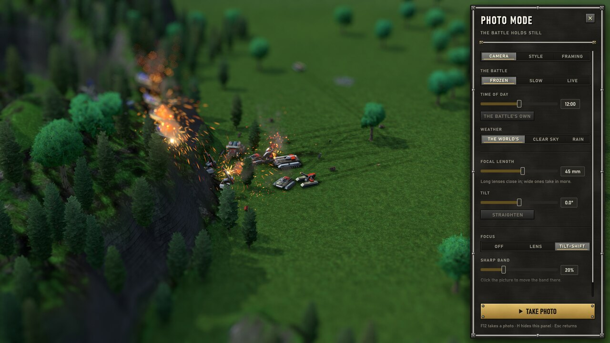<br><sub><b>Photo mode</b>: freeze or slow the battle; lenses, looks, tilt-shift, up to 4K</sub></td>
  </tr>
</table>

<details>
<summary><b>More about command and control</b>: the deck, the radial menu, duties, formations, TA's rules, accessibility</summary>

<br>

- **The command deck**: the selection's card says what it is doing; beside it a mixed selection's
  kinds and the switches that narrow it, a factory's or a constructor's queue, or one kind's key
  figures; the orders keep their keys, the standing orders show their setting with lamps, and the
  build menu spreads out as wide as it needs. Units are pictured by portraits drawn from their own
  models in their owner's colours.
- **The radial menu**: right-click (or hold the button) on one of your units and its orders unfold
  in a ring of gunmetal and brass plates round the pointer: attack, stop, its fire and move orders,
  perspective, self-destruct; a factory's units with their costs, a builder's buildings by purpose.
  The unit stands in the middle with its health round it; each plate shows its key, lights as the
  pointer or the stick comes to it, and turns into its ring (and back) without losing your place.
  The mouse, the keys or a gamepad's stick pick them; reduced motion and reduced flashes are kept.
- **Duties**: put a constructor, or the Commander, to work on its own: *Economy* (extractors and
  power, then makers and storage), *Repair*, *Reclaim* or *Defence*, from its DUTY button, Alt+D or
  the radial menu. It is tagged on the map, no longer counted idle, kept in saved games, says what
  it is waiting for or why it has nothing to do, and is yours again with any order.
- **The figures where you look**: a building hovered says what it makes and uses of metal and
  energy; a building going up shows, small and dim, the time it has left; radar, sonar and jammers
  show their reach when selected, hovered or placed.
- **Notices you can follow**: an attack, an ally's signal or the coach's advice comes with LOOK,
  which takes the camera there; F3 steps back through the alerts. Tips keep out of the way, wait
  while the pointer is on them, and can be put away for good.
- **Armies move as armies**: a group order lays its units out in a formation, as in Supreme
  Commander; they march at the pace of the slowest and arrive in shape, facing the way they went.
  The movement rule "As in TA" keeps the old way.
- **TA's controls, all of them**: Ctrl+click force fire, the Ctrl+letter selections, TA's order keys,
  F1 on a unit for everything TA told about it, factories that feed their squads, the chat commands.
- **And modern ones**: area orders, formation lines drawn with Ctrl+drag, factory routes, control
  groups with a bar of their own, camera bookmarks, idle alerts, a battle history (Alt+H), units
  that give way to each other in traffic.
- **TA's rules of engagement**: each weapon picks its targets as TA's files say (anti-air leaves
  tanks and ships alone, and ground guns leave aircraft to it), and the long-range guns are built
  holding their fire. A nuke fired at a unit comes down where the unit stood at the launch: its radar
  path shows the trail behind it, the way ahead and the seconds to impact.
- **Two cameras**: a modern 3D camera that turns and tilts, or TA's own top-down view (F5).
- **The companion screen** (Alt+C) puts the battle's map at full size on a second display beside the
  economy, your forces, your factories and the battle's events; a click there looks or orders, and
  it never takes the keyboard from the battle.
- Rebindable keys, left- or right-button orders, gamepads (the Steam Deck's too), colour-blind
  colours, interface scaling and reduced motion ([accessibility guide](docs/ACCESSIBILITY.md)).

</details>

<br>

<a id="ways-to-play"></a>
<p align="center">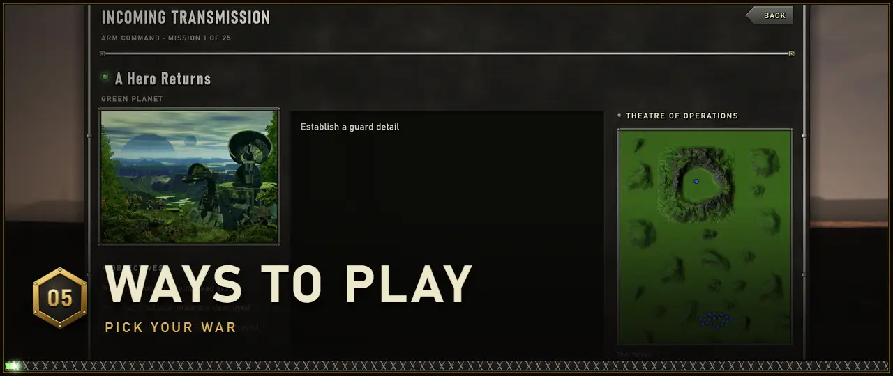</p>

Every campaign of your install, briefed as TA gave them. Skirmish for ten. A galaxy to conquer
system by system. Thirteen scenarios with goals of their own. Multiplayer that stays in step. And
every battle recorded, to watch back as a broadcast or save as a film.

<table>
  <tr>
    <td width="50%" align="center">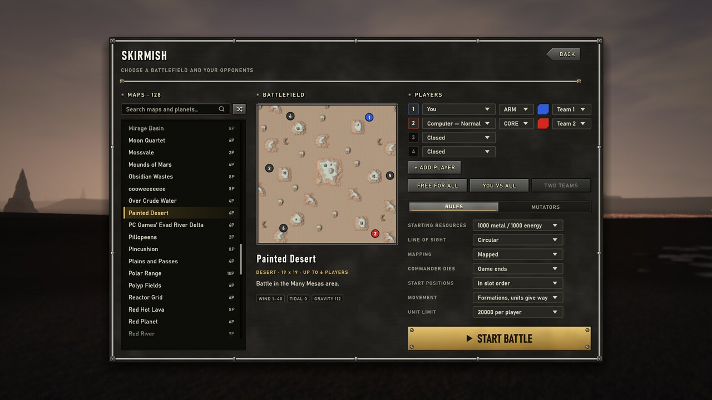<br><sub><b>Skirmish</b>: up to ten players in teams on every map of your install</sub></td>
    <td width="50%" align="center">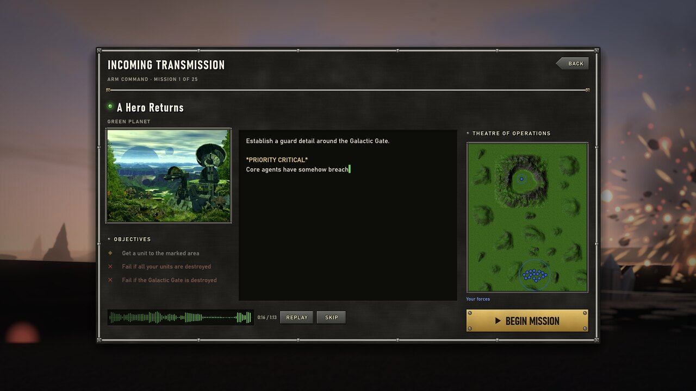<br><sub><b>The campaigns</b>, briefed as TA gave them: an incoming transmission</sub></td>
  </tr>
  <tr>
    <td align="center">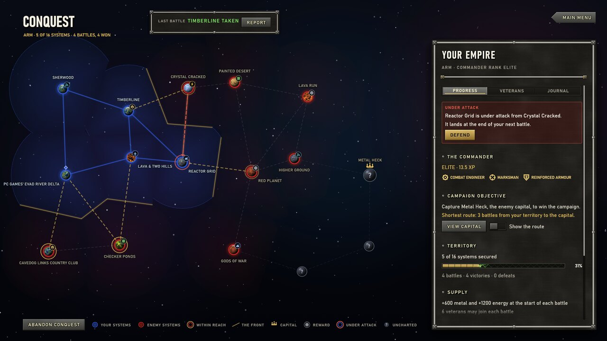<br><sub><b>Conquest</b>: take a galaxy of TA's worlds system by system</sub></td>
    <td align="center"><br><sub><b>Scenarios</b>: thirteen battles with goals of their own</sub></td>
  </tr>
  <tr>
    <td align="center"><br><sub><b>The debrief</b>: what decided the battle, your figures, your best unit</sub></td>
    <td align="center"><br><sub><b>The cast view</b>: replays as a tournament's broadcast</sub></td>
  </tr>
</table>

| Mode | What it is |
| --- | --- |
| **Skirmish** | Up to ten players in teams (free for all, you against all, two teams, or your own), computer players at three levels, starting rules, mutators, TA's line of sight choices |
| **Campaigns** | Every campaign of your install (Arm and Core, The Core Contingency's, Battle Tactics'), with TA's own mission scripts and briefings |
| **Conquest** | A galaxy of TA's worlds taken system by system: rewards for every system held, counter-attacks to beat off, veterans carried from battle to battle, and a Commander who earns perks at each promotion |
| **Scenarios** | Last Stand, King of the Hill, Extraction, Decapitation, Doomsday Clock, Metal Rush, Armageddon, Endless Siege, Until Dawn, Titans, Iron Rain, The Armistice and Brothers in Arms, on three difficulties; your own as TOML files |
| **Multiplayer** | Lockstep over a local network or the internet: a lobby, spectators, chat, rejoining, an ally taking over a lost player's army |
| **Replays** | Every game recorded: seek backwards and forwards, rewind, watch it as a cast, see its highlights, or **export it as an MP4** (720p to 4K, with the battle's sounds and music); EXPORT CLIP cuts its best 30 or 60 seconds for social media, vertical or horizontal |
| **Tutorial** | Five short lessons, each step spoken aloud in thirteen languages, and field notes on the loading screen |

<a id="computer-players"></a>

### Someone to fight

<p align="center">
  
</p>

The computer players run their economies and tech, build defences, raid, send attack waves, air
strikes and nukes, fight at sea and ferry armies across the water. **They play fair**: a computer
player knows only what a player in its seat could. It sees what its team's units see, takes a radar
blip for no more than a blip, and sends a scout to find your base before it plans its war.

**They also talk.** Each enemy is a persona with a name and a title (an Arm field commander, a Core
machine intelligence, a mercenary), and their lines come in as transmissions: static as the link
is made, the words typed out as they speak. They greet you, taunt you, answer what you ask on the
chat line, mourn their experimentals, make a last stand when their factories fall. And they
remember you: an enemy Commander you have fought before greets you by who won last time.

<details>
<summary><b>More about the computer players, highlights and cheats</b></summary>

<br>

- **Hard** pulls hurt units back for repairs, concentrates its fire and fights island wars from the
  air. Every level starts from the map's start positions, as you do from the lobby, and sends a
  scout (or a scout plane, across water) to find your base; it remembers your buildings as it last
  saw them.
- **Highlights**: after a battle, its decisive moments replay with a circling camera and slow
  motion; WATCH HIGHLIGHTS is a click away on the result page.
- **Cheats** work in single player: TA's codes (`+atm`, `+nowisee`, `+radar`…) and new ones (`+god`,
  `+instant`, `+spawn peewee 10 enemy`), with a panel that places any unit anywhere. A cheat costs
  the battle its career: its XP, records and achievements are taken back.

</details>

<br>

<a id="the-launcher"></a>
<p align="center"></p>

The launcher finds your GOG or Steam copy by itself, checks what is there, sets the graphics up for
your computer and keeps TA Reborn up to date. Its Play page is a command deck: PLAY, a quick start
for every way to play, and your battles to continue or watch.

<table>
  <tr>
    <td width="50%" align="center"><br><sub><b>Mods</b>: ModDB's conversions in one library, a click to install</sub></td>
    <td width="50%" align="center"><br><sub><b>Maps</b>: every map with a picture of its own terrain</sub></td>
  </tr>
  <tr>
    <td align="center"><br><sub><b>Skins</b>: nineteen skins and an editor for your own</sub></td>
    <td align="center"><br><sub><b>Your career</b>: profiles, XP, 21 ranks and 134 achievements</sub></td>
  </tr>
</table>

<details>
<summary><b>More about the launcher</b>: mods, maps, skins, commander profiles, the benchmark</summary>

<br>

- **Mods**: the catalogue's community conversions (TA: Escalation, Total Mayhem, Talon, Total
  Battletech, The Final Frontier and more) and your installed mods in one library: search, filter,
  install in a click, update all; see what each mod changes; drag the load order into place; hide
  the catalogue's mods you never want to see. Every mod is checked in the background against the
  game without it, so what it breaks counts and what was broken before does not. A right-click on
  any card or row of the Mods, Maps and Skins libraries opens what can be done with it.
- **Maps**: cards with each map's own terrain, filters by players, size, world and source,
  favourites, a random pick; details with the numbered start positions, PLAY, SET UP SKIRMISH and
  EDIT A COPY; map archives imported in a click.
- **Skins**: every skin on your units; use it for your army or the enemy; **make your own** in the
  editor (a pattern from tiles in your colours, palettes, finish and weathering, pictures of your
  own on the armour, all live, with undo) and share `.taskin` packs ([guide](docs/UNIT_SKINS.md)).
- **Commander profiles**: several people on one device, each with their own settings, saves,
  campaign progress and career. Playing earns XP for time, kills, units and buildings, captures,
  economy and results; **twenty-one ranks** from Recruit to Commander, each with its insignia, and
  service stars past level 100. **134 achievements** in six categories and four tiers, each with
  its own medallion, a notice when earned and a picture of the moment kept for its page
  ([catalogue](docs/ACHIEVEMENTS.md)).
- **Benchmark**: eight staged scenes on TA Reborn's own worlds, up to twenty thousand units at once,
  and two tests: the settings, and what each effect costs. Scores for your graphics card, processor
  and memory against an RTX 4080 with a Ryzen 9 5950X (10,000 each), and the settings that hold 60
  frames a second; a quick run takes about a minute and a half.
- **And**: quick starts for skirmish, campaign, tutorial and the map editor; your recent saves and
  replays, each naming the mods it needs; TA's calmer music playing quietly; seasonal dress at
  Halloween, Christmas and the New Year; brass pointers that breathe; keyboard help on F1 and
  search on Ctrl+F; an About page with the credits and the way to the website.

</details>

<br>

<a id="worlds"></a>
<p align="center"></p>

Twenty-nine maps of TA Reborn's own, grown by its map generator and shipped with the game, beside
every map of your install. The duels and team maps are point-symmetric, every base has level
ground and its metal close by, and on land maps a tank can drive from every base to every other.
The real places are as they are, their bases at their cities.

<p align="center">
  
</p>

| | |
| --- | --- |
| **Forests** | Mossvale, Timberline, Greenmantle, and Highland Rift's river canyon |
| **Deserts** | Sunscar Dunes, Redstone Mesas, Mirage Basin |
| **Islands** | Twin Reefs, Crescent Keys, Stormbreak Archipelago, Sapphire Reach, and Shore to Shore Reborn's two coasts across a wide ocean |
| **Fire** | Embergate, Furnace Caldera, Obsidian Wastes, Cinder Basin's molten rivers |
| **Metal** | Foundry Deck, Reactor Grid, Hammerfall Works: decks of plating over coolant canals |
| **Space** | Rift Belt, Lagrange Station, Starfall Expanse: rocks adrift over a planet, joined by gantries |
| **Winter** | Frostfall Hollow, Hollyridge, Midnight Square, First Light Peaks: villages lit by night, fireworks at New Year |
| **Real places** | Australia, the United States and the whole world, their coasts and lakes from Natural Earth |

<table>
  <tr>
    <td width="50%" align="center"><br><sub><b>Australia</b>, 28 x 24 for eight players, alone in its ocean</sub></td>
    <td width="50%" align="center"><br><sub><b>Lagrange Station</b>: six rocks round a station, a planet far below</sub></td>
  </tr>
  <tr>
    <td align="center"><br><sub><b>Hollyridge at Christmas</b>: the great fir lights up at dusk</sub></td>
    <td align="center"><br><sub><b>Midnight Square</b>: a truce under the fireworks</sub></td>
  </tr>
</table>

<br>

<a id="mods"></a>
<p align="center"></p>

Mods need no code. They load from folders or TA's own archives, and the big conversions install
from the launcher and play with all their units. Then make your own: maps in the editor, skins in
theirs, scenarios as plain files.

https://github.com/user-attachments/assets/0c29747c-1139-4f19-877a-3661836a55c5

<p align="center"><sub>Mod support, filmed in the game: TA: Escalation, Total Mayhem and TA: Enhanced, each installed by the launcher. The mods are their teams' work: the TA: Escalation Mod Group, Mayhem Inc and Firmament.</sub></p>

<table>
  <tr>
    <td width="50%" align="center"><br><sub><b>The map editor</b>: shape the ground, paint, place features and starts, test-play</sub></td>
    <td width="50%" align="center"><br><sub><b>F1 on any unit</b>: everything TA's data says about it, mods' units too</sub></td>
  </tr>
</table>

<details>
<summary><b>More about mods and making</b>: how mods load, saved games, the validator, the map editor, ta-tools</summary>

<br>

- **Mods need no code**: they load from folders or TA's own archives, later ones over earlier ones,
  and the rules and the computer players read unit properties. A mod's archive named like one of
  the game's takes its place, as installing it in TA's folder did. Mods made for patched original
  engines can load their own sides.
- **The big conversions play**: TA: Escalation, Total Mayhem and TA: Enhanced install from the
  launcher (or from the file you downloaded) and play with all their units: painted however many
  textures they bring, their walkers and turrets moving as their scripts tell them, their missiles
  guided, their nukes nuclear.
- **Saved games and replays remember their mods**: each keeps the mods it was played with, by name,
  version and contents. The lists say what a battle needs; opening one whose mods are missing, off
  or changed offers to turn them on, to get them in the launcher, or to load it anyway.
- **Every mod is checked** for its files, references, sounds and packaging, against the game without
  it; a readable report says where and how to fix it ([MOD_VALIDATION.md](docs/MOD_VALIDATION.md),
  or `ta-tools validate-mod` for a mod's own build).
- **The map editor** works on new maps or copies of existing ones: tools by name, a status bar, the
  map in miniature, a check for problems and TEST PLAY; it takes your pictures as heights, art or
  tile brushes, shows features as pictures and scatters them, and saves maps as mods the skirmish
  page lists at once.
- **`ta-tools`** inspects, converts and validates TA's data files (`validate`, `map`, `gaf`, `model`,
  `cob`, `cat`, `find`…), and grows TA Reborn's maps (`mapgen`; [MAPS.md](docs/MAPS.md)).

</details>

<br>

<a id="the-archives"></a>
<p align="center"></p>

TA Reborn keeps what made the original loved. Its intro plays on a 19-inch CRT in a bedroom late
at night in 1997. Its story is told over a living galaxy. Every unit stands on show, and the
credits name everyone who made the game, read from your install.

<table>
  <tr>
    <td width="50%" align="center"><br><sub><b>Every unit</b>, mods' too, standing, moving or firing; wallpapers up to 8K</sub></td>
    <td width="50%" align="center"><br><sub><b>The Galactic War</b>: the war's chronicle over a living galaxy</sub></td>
  </tr>
  <tr>
    <td align="center"><br><sub><b>The title screen</b> films TA Reborn's worlds behind it, a scene at a time</sub></td>
    <td align="center"><br><sub><b>The credits</b>, a film timed to a song of their own</sub></td>
  </tr>
</table>

<details>
<summary><b>More about the archives</b>: the encyclopaedia, the intro's room, the Galactic War, the credits, the languages</summary>

<br>

- **The encyclopaedia** lists every unit by side and kind, in its side's colours, beside everything
  TA's F1 page tells and the build chain that makes it; WALLPAPER saves the very picture you frame.
- **The intro's room** is a modelled bedroom lit by the moon through the blinds. The camera comes in
  to the desk as the CRT warms up and degausses, and the movies light the room in their colours. On
  the desk: a lava lamp, a modem blinking on the tower, a turbo display reading 166, a flight stick,
  and a battle planned in pen on a print of one of your maps. It follows the launcher's seasonal
  setting: through December a little tree twinkles on the speaker, with presents, fairy lights, a
  stocking and snow at the window; on New Year's Eve and Day the room holds a party, with balloons,
  streamers, a banner and fireworks over the street.
- **The Galactic War** tells TA's story in twelve chapters of its own. Each plays over a painting of
  the galaxy as it stood then: CORE's worlds in the middle, the ARM's rim, the front, burned worlds,
  fleets under way. The galaxy eases from chapter to chapter as the text is typed out, or plays
  through as a film. Its archive holds documents from both sides: CORE's edict, the ARM's
  declaration, a clone trooper's letter home, an intercepted signal, the Krogoth's threat
  assessment. Every campaign's missions lie on their worlds, ready to play.
- **The title screen** is a film of short scenes staged live on TA Reborn's worlds, each with its own
  light, weather and camera; leave it a while (or press WATCH) and the menu steps aside for it.
- **The credits** are a film timed to their own song, Hadal Static's "The War Reborn": a battle
  across six worlds in which the names (Cavedog's teams, read from your install, and TA Reborn's)
  lie on the ground, burn, are projected or built, each card on a bar of the music, the acts on its
  sections, a nuke on its loudest bar.
- **The loading screen** builds the emblem with two nano-lathes while you wait, and **a jukebox**
  plays TA's soundtrack by its parts with your own music beside it.
- **Fourteen languages**: English, German, French, Spanish, Italian, Brazilian Portuguese, Polish,
  Russian, Ukrainian, Turkish, Japanese, Korean, and Simplified and Traditional Chinese.

</details>

<br>

<a id="get-started"></a>

## Get started

<p align="center">
  <a href="https://github.com/Jared-woodruff/TA-Reborn/releases/latest"></a>
</p>

1. **Own Total Annihilation.** The Commander Pack (with The Core Contingency and Battle Tactics),
   from [GOG](https://www.gog.com/game/total_annihilation_commander_pack) or from
   [Steam](https://store.steampowered.com/app/298030/): both ship the same data files. Other copies
   work too.
2. **Download TA Reborn** from [Releases](https://github.com/Jared-woodruff/TA-Reborn/releases/latest),
   for **x64** or **ARM64**:

   | System | Take |
   | --- | --- |
   | **Windows** | the setup (`…-setup.exe`), or the portable ZIP |
   | **macOS** | the disk image (`.dmg`), or the app ZIP |
   | **Linux** | the Ubuntu package (`.deb`), the Arch package (`.pkg.tar.zst`), or the portable archive |

3. **Start TA Reborn.** The launcher finds GOG and Steam installs by itself, checks what is there and
   sets the graphics up for your computer. Create your commander profile (a name, a picture and an
   allegiance) and press PLAY.
4. **Run the benchmark** (optional) from the BENCHMARK page for the settings that suit your computer.

| | Needs | Best with |
| --- | --- | --- |
| **Systems** | Windows 10+ x64 / Windows 11 ARM64; macOS 13+ Intel or Apple Silicon; Ubuntu 22.04+ / Arch Linux x64 / Arch Linux ARM | |
| **Graphics** | DirectX 12 or Vulkan on Windows, Vulkan on Linux, Metal on macOS; integrated graphics on Low | 6 GB of video memory for High, 10 GB for Ultra; a card that traces rays for ray tracing |
| **The game** | Total Annihilation, legitimately owned | The Commander Pack, both expansions |

> [!NOTE]
> This page shows the current development build. The latest release is
> [1.0.0](https://github.com/Jared-woodruff/TA-Reborn/releases/latest); [CHANGELOG.md](CHANGELOG.md)
> says what each release brought.

Settings, mods, skins and downloads live in `%APPDATA%\TA Reborn` (each commander's own below
`profiles\<id>`); screenshots and photos in `Pictures\TA Reborn`; videos made from replays in
`Videos\TA Reborn`. See the [release and platform guide](docs/RELEASING.md) for packages and the
[profile and Maps guide](docs/LAUNCHER_MAPS_CAREER.md) for the launcher's pages.

<a id="faq"></a>

## Questions people ask

<details>
<summary><b>Do I need to own Total Annihilation?</b></summary>

<br>

Yes. TA Reborn is an engine. It ships no units, maps, art, sound, music or video; it reads them
from your copy. The Commander Pack from GOG or Steam has everything it can use, and other
copies work too.

</details>

<details>
<summary><b>Is this official?</b></summary>

<br>

No. It is an unofficial fan project, not affiliated with or endorsed by the game's owners. It is a
clean-room reimplementation: written from the community's published research on TA's file formats
and from playing the game, without the original's code. It is free software under the GNU GPL v3.

</details>

<details>
<summary><b>Will it change my Total Annihilation install?</b></summary>

<br>

No. It reads the game's files where they are. Its own settings, saved games, mods and downloads
live in TA Reborn's folder (`%APPDATA%\TA Reborn` on Windows), and the original game goes on
working as it did.

</details>

<details>
<summary><b>Do my mods work?</b></summary>

<br>

Many do, with no code: mods load from folders or TA's own archives. TA: Escalation, Total Mayhem
and TA: Enhanced install from the launcher and play with all their units. The launcher checks every
mod against the game without it and says, readably, what fits and what does not
([how mods are checked](docs/MOD_VALIDATION.md)).

</details>

<details>
<summary><b>Can I play online with people running the original game?</b></summary>

<br>

No. Multiplayer is TA Reborn's own: lockstep over a local network or the internet, with a lobby,
spectators, chat and rejoining. Everyone in a battle runs TA Reborn; players with different map
packs can still play together, and a join that cannot go ahead says which mods differ.

</details>

<details>
<summary><b>Does it play like TA?</b></summary>

<br>

That is the point. The simulation runs at TA's 30 ticks a second, units run TA's own scripts,
weapons pick their targets as TA's files say, and TA's keys, commands and cheat codes work. What is
new is a choice: formations or TA's movement, the command deck or TA's panel, the 3D camera or
TA's view.

</details>

<details>
<summary><b>Windows or macOS warns me about the download. Why?</b></summary>

<br>

The packages are not signed with a paid certificate yet, so Windows SmartScreen asks before the
setup's first start, and macOS asks you to approve the app in System Settings › Privacy & Security.
Every release lists SHA-256 sums for its files, so you can check what you downloaded.

</details>

<details>
<summary><b>What does it need to run well?</b></summary>

<br>

Integrated graphics play it on Low. For High, a card with 6 GB of video memory; for Ultra, 10 GB;
for ray tracing, a card that traces rays. The launcher's benchmark measures your computer and
proposes the settings that hold 60 frames a second.

</details>

<details>
<summary><b>How can I help?</b></summary>

<br>

Play it and [report what breaks](https://github.com/Jared-woodruff/TA-Reborn/issues). Correct a
translation: the fourteen languages are plain TOML files in `lang/`
([guide](tools/i18n/README.md)). Try your favourite mod and send its report. Or read
[docs/ARCHITECTURE.md](docs/ARCHITECTURE.md) and [docs/ROADMAP.md](docs/ROADMAP.md) and open a
pull request; contributions are accepted under the project's licence.

</details>

<a id="build"></a>

## Build from source

With [Rust](https://rustup.rs) 1.95 or newer and the game installed:

```bash
cargo run --release -p ta_game -- --map "Coast To Coast"
```

```bash
cargo run --release -p ta_launcher
```

```bash
cargo test --release --workspace --locked
```

The tests that read game data skip themselves when no install is found; `ta_formats` writes and
re-reads every map of the install. The Windows installer is built with
`powershell -ExecutionPolicy Bypass -File installer\build_installer.ps1` (needs
[NSIS 3](https://nsis.sourceforge.io); see [installer/README.md](installer/README.md)); native Linux and
macOS packages with `installer/build_linux.sh` and `installer/build_macos.sh`. The
[release guide](docs/RELEASING.md) covers all six targets.

<details>
<summary><b>Handy flags for development</b></summary>

<br>

| Flag | What it does |
| --- | --- |
| `--map "<name>"` | Straight into a skirmish on that map |
| `--profile <id>` | Launch under a specific commander profile |
| `--classic` | TA's 1997 oblique view instead of the free camera |
| `--mission "arm campaign:0"` | Straight into a campaign mission |
| `--scenario last-stand` | Straight into a scenario |
| `--host PORT` / `--join ADDR` | The multiplayer lobby |
| `--replay x.tarep` / `--load x.tasav` | Watch a replay, continue a saved game |
| `--editor ["<map>"]` | The map editor on a copy of that map, or a new one |
| `--demo battle\|nuke\|naval\|swarm\|perspective\|stage` | Scripted scenes for captures and testing |
| `--screenshot out.png --frames N` | Capture after N frames, then exit (`TA_SHOTS=n` films a strip) |

</details>

<a id="under-the-hood"></a>

## Under the hood

The simulation runs at TA's 30 ticks a second in fixed-point arithmetic, with table trigonometry and
its own random numbers, so every computer playing a game computes the same battle: that is what
lockstep multiplayer, replays and rewinding stand on. TA's own unit scripts (COB) run in a virtual
machine inside it, and the computer players give the same orders a player does. It is 64-bit
throughout, with room to grow for mods: maps up to 16,384 cells a side, 256 unit categories, 64
players inside the game, and build times exact however long.


| Folder | What it is |
| --- | --- |
| `crates/ta_formats` | TA's file formats: HPI archives, GAF, 3DO, COB, TNT, TDF, PCX… |
| `crates/ta_vfs` | Finds the install (GOG, Steam or a folder), mounts the archives, TA Reborn's maps and the mods as one file system |
| `crates/ta_data`, `ta_sim` | Game data, and the deterministic 30 Hz simulation with the COB script VM |
| `crates/ta_ai` | The computer players |
| `crates/ta_render`, `ta_audio`, `ta_video` | The wgpu renderer, sound and music, TA's movies |
| `crates/ta_net`, `ta_config`, `ta_ui`, `ta_skins`, `ta_mp4` | Lockstep multiplayer, settings and careers, the shared interface, unit skins, video export |
| `apps/ta_game`, `ta_launcher`, `ta_tools` | The game, the launcher, the data tools and map generator |

[docs/ARCHITECTURE.md](docs/ARCHITECTURE.md) explains how it all works,
[docs/FORMATS.md](docs/FORMATS.md) the verified facts about TA's formats, and
[docs/ROADMAP.md](docs/ROADMAP.md) what is done and what is open.

<a id="credits"></a>

## Credits and licence

- **Project Lead:** Jared Woodruff ([github.com/Jared-woodruff](https://github.com/Jared-woodruff))
- **DEV:** Claude Opus 5.5 by Anthropic
- **QA:** GPT6 Astra by OpenAI
- **VO:** Kokoro-82M by Hexgrad
- **VO:** Chatterbox by Resemble AI
- **Website:** [ta-reborn.com](https://ta-reborn.com/)
- **Built with:** Rust, wgpu, winit, egui and eframe, symphonia, cpal, glam, rayon, serde and the
  other libraries listed in `THIRD-PARTY-NOTICES.txt`; the original art made with Blender and Python
  (NumPy, Pillow), its models packed with gltfpack; the installer built with NSIS
- **Map data:** coastlines and lakes from [Natural Earth](https://www.naturalearthdata.com)
- **Music:** "The War Reborn" by Hadal Static, the credits' song (and the launch trailer's), used
  with permission
- **Thanks:** the Total Annihilation community, whose decades of file-format research made this
  possible, and everyone who has kept Total Annihilation alive since 1997
- **Total Annihilation:** Cavedog Entertainment, 1997. The game's credits name its teams, read from
  your install

Copyright © 2026 TA Reborn contributors. TA Reborn is free software: you can redistribute it and/or
modify it under the terms of the [GNU General Public License](LICENSE) as published by the Free
Software Foundation, either version 3 of the License, or (at your option) any later version. It is
distributed in the hope that it will be useful, but without any warranty; see the licence for
details. Contributions are accepted under the same terms. The third-party libraries it is built
with keep their own licences; the release
packages list them in `THIRD-PARTY-NOTICES.txt` (`ta-tools notices` writes it).

The music of the credits, "The War Reborn" by Hadal Static, is © Hadal Static, all rights
reserved, and is used with permission: it is not covered by the GPL
(`assets/reborn/music/NOTICE.txt`).

Total Annihilation is © its respective owners. TA Reborn is an unofficial fan project, not
affiliated with or endorsed by them. The pictures on this page are of TA Reborn playing the original
game's data from a legitimately owned copy.

<p align="center"></p>
